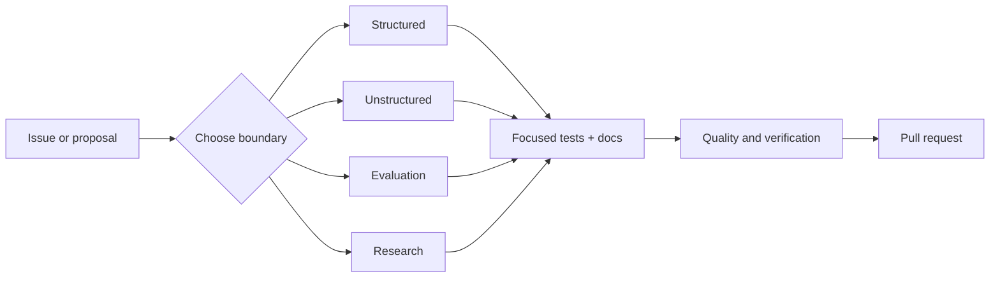

# Contributing

Thanks for helping improve Data-to-Knowledge Graph Construction. Contributions are welcome when they preserve the repository’s modelling invariants, evidence guarantees, and explicit separation between product evaluation and research comparison.

[Project overview](README.md) · [Architecture](docs/architecture.md) · [Modelling rules](docs/knowledge_graph_modelling.md) · [Testing](docs/testing_guide.md) · [Code of Conduct](CODE_OF_CONDUCT.md)

## Choose the correct boundary

Every change must have one clear owner:

| Area | Canonical namespace or path | Appropriate changes | Not appropriate here |
| --- | --- | --- | --- |
| Structured construction | `kg_construction.structured` | Identity rules, categorical reuse, source catalogues, table and semi-structured mappings | Technique leaderboards |
| Unstructured construction | `kg_construction.unstructured` | Mentions, semantic assertions, qualifiers, evidence, resolution, promotion and quarantine | Business-domain “claims” logic |
| Evaluation | `kg_construction.evaluation` | Formation, task, schema, identity, and intended-use metrics | Weighted technique ranking |
| Composition and shared runtime | `kg_construction.construction`, domain, ports, and infrastructure | Root API composition, shared contracts, graph-store integrations | A fourth product pillar |
| Research | `kg_construction.research`, [`research/`](research/), [`benchmarks/`](benchmarks/) | Comparisons, leaderboards, Graph ML experiments, synthetic fixtures | Publication or certification evidence |
| Certification | [`certification/`](certification/) | Locks, platform profiles, nonce-bound execution evidence, release decisions | Pre-authored or mocked success reports |



Technique comparisons, leaderboards, mocked-provider demonstrations, dataset experiments, and Graph ML exploration belong to `kg_construction.research`. Research results must never be presented as publication or certification evidence.

## Development setup

The product has one mandatory dependency set. It does not use feature extras for GLiNER, Transformers, spaCy, MLX, Ollama, Neo4j, entity linking, graph stores, or Graph ML.

```bash
git clone https://github.com/swaroop-kaza/knowledge_graphs.git
cd knowledge_graphs
uv sync --frozen --all-groups
```

When working on live providers, stores, runtime profiles, or certification, provision and validate the complete selected platform:

```bash
make setup
uv run kg-construction doctor --strict
```

Apple Silicon contributors must exercise MLX and Torch MPS. Linux contributors exercise the applicable CPU or CUDA profile. Platform-inapplicable MLX on Linux is not reported as a skip. The [getting-started guide](docs/getting_started.md) explains profile provisioning and required services.

## Contribution workflow

1. Read the relevant modelling and technique guide before changing behavior.
2. Keep the change inside one canonical boundary unless the feature genuinely requires coordinated cross-boundary composition.
3. Add focused tests for the changed contract and a regression test for every bug fix.
4. Update examples, configuration, and user-facing documentation in the same change.
5. Run the checks appropriate to the change.
6. Open a pull request using the repository [pull request template](.github/PULL_REQUEST_TEMPLATE.md).

### Required verification

| Change scope | Minimum checks |
| --- | --- |
| Documentation only | `make docs-check`; also run `make notebook-check` when notebook navigation changes |
| Product code or configuration | `make quality`, `make test`, `make product-smoke`, `make package-check` |
| Research code or fixture | Product checks plus `make research-smoke` |
| Provider, service, store, model, runtime, evaluation gate, or certification | `bash run_all_approaches.sh` |

The common product checks are:

```bash
make quality
make test
make product-smoke
make package-check
```

Run research checks separately when comparison code changes:

```bash
make research-smoke
```

Run the complete release contract for provider, service, store, model, evaluation, runtime, or certification changes:

```bash
bash run_all_approaches.sh
```

See the [testing guide](docs/testing_guide.md) for focused test locations, fixtures, report gates, and the difference between product smoke and certification.

## Engineering rules

- Keep graph identity and relationship decisions independent of storage vendors.
- Keep structured, unstructured, evaluation, and research imports within their canonical namespace boundaries.
- Treat `Claim` as the implementation name for an evidence-grounded semantic assertion; preserve its exact evidence, intent, qualifiers, and provenance.
- Return evidence-backed observations from extractors; do not write directly to a graph store from extraction code.
- Never silently downgrade or substitute a mandatory model or service provider.
- Treat every provider applicable to the selected certification profile as required.
- Keep cross-source identity comparisons and relevance judgments in their proper evaluation or research scope; neither defines the construction schema.
- Add or update focused tests for every loader, mapper, extractor, resolver, validator, evaluator, graph builder, or graph-store change.
- Update user-facing documentation and examples whenever behavior or a boundary changes.
- Keep generated draft output in `data/processed/` and high-volume research output outside authoritative reports.
- Prefer comments that explain modelling invariants or non-obvious constraints; remove comments that restate code or describe obsolete behavior.

## Documentation standards

- Use descriptive link text and relative links for repository files.
- Keep normal prose as one Markdown paragraph instead of inserting editor-width line breaks.
- Use a table when readers need to compare several exact options, owners, or commands.
- Use a diagram only when it makes flow, hierarchy, or trust boundaries easier to understand.
- Label draft, research, mocked, and certified results precisely.
- Keep examples runnable and point to the source configuration or fixture they use.
- Do not commit generated notebook output, absolute local paths, secrets, downloaded datasets, or model artifacts.

## Pull request checklist

- [ ] The change is assigned to a product pillar or explicitly to research.
- [ ] Tests were added or updated.
- [ ] `make quality` passes.
- [ ] `make test` and `make product-smoke` pass.
- [ ] `make package-check` passes.
- [ ] `make research-smoke` passes when research code changed.
- [ ] The mandatory hard pass was run when runtime or certification behavior changed.
- [ ] Documentation and examples match the final behavior.
- [ ] No generated secrets, downloaded datasets, model artifacts, or notebook outputs were committed.

## Community and security

Use the repository issue templates for [bug reports](.github/ISSUE_TEMPLATE/bug_report.yml) and [feature requests](.github/ISSUE_TEMPLATE/feature_request.yml). Read [SUPPORT.md](SUPPORT.md) for help channels and [SECURITY.md](SECURITY.md) before reporting a vulnerability. Participation is governed by the [Code of Conduct](CODE_OF_CONDUCT.md).
