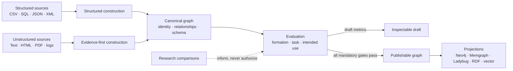
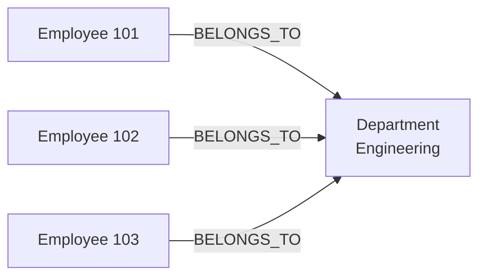
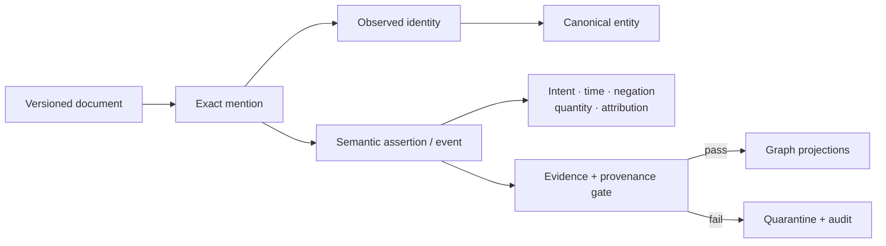

# Data-to-Knowledge Graph Construction

[](https://github.com/swaroop-kaza/knowledge_graphs/actions/workflows/ci.yml)
[](pyproject.toml)
[](LICENSE)

`kg_construction` turns structured and unstructured data into knowledge graphs whose identity, relationships, evidence, schema, and fitness for use are measurable.

> **Core principle:** a graph store cannot repair a graph that was formed incorrectly. This project governs construction first, evaluates the result, and only then materializes it for Neo4j, Memgraph, Ladybug, RDF, NetworkX, or vector-backed use.

[Getting started](docs/getting_started.md) · [Architecture](docs/architecture.md) · [Modelling rules](docs/knowledge_graph_modelling.md) · [Evaluation](docs/evaluation_metrics.md) · [Configuration](docs/configuration.md) · [Contributing](CONTRIBUTING.md)

## What this repository solves

The product is organized around exactly three pillars:

| Pillar | Construction goal | Problems explicitly guarded against | Start here |
| --- | --- | --- | --- |
| **Structured data → graph** | Turn tables and semi-structured records into stable entities, shared concepts, and typed relationships. | Duplicate categorical nodes, unstable identifiers, fabricated foreign-key targets, and incorrect n-ary modelling. | [Structured construction techniques](docs/techniques_structured_to_kg.md) |
| **Unstructured data → graph** | Recover entities, relations, events, intent, and qualifiers while preserving exact source evidence. | Missed intent, unsupported assertions, span drift, false entity merges, and provenance loss. | [Unstructured construction techniques](docs/techniques_unstructured_to_kg.md) |
| **Evaluation** | Measure formation, task correctness, schema quality, and fitness for each declared graph use. | “Looks plausible” graphs, proxy-only scores, skipped metric families, and weighted rankings mistaken for release gates. | [Evaluation metrics](docs/evaluation_metrics.md) |



## Run the complete repository

### Prerequisites

| Requirement | Why it is needed |
| --- | --- |
| Python 3.11 or 3.12 | Supported package runtime |
| [`uv`](https://docs.astral.sh/uv/) | Immutable Python dependency installation |
| Docker with Compose | Digest-pinned Neo4j, Memgraph, and Ollama services |
| Sufficient model storage | GLiNER, Transformers, sentence-transformers, Qwen3, spaCy, and platform-specific MLX artifacts are mandatory |
| Apple Silicon or Linux CPU/CUDA | Selects the applicable locked certification profile |

Follow the [getting-started guide](docs/getting_started.md) for platform-specific bootstrap instructions. The complete path is:

```bash
git clone https://github.com/swaroop-kaza/knowledge_graphs.git
cd knowledge_graphs

make release-locks
make setup
bash run_all_approaches.sh
```

`make release-locks` is an explicit online maintainer operation and can download large artifacts. After provisioning, the hard pass disconnects dependency and model registries while still allowing declared live reconciliation capabilities to call their remote endpoints. See the [certification contract](certification/README.md) for the exact trust boundary.

On Apple Silicon, the mandatory profile includes Torch MPS and MLX/MLX-LM. Every profile includes GLiNER, GLiNER RelEx, Transformers NER, spaCy, Qwen3 through Transformers and Ollama, embedding and cross-encoder resolution, Neo4j, Memgraph, Ladybug, and RDF. MLX is platform-applicable on Apple Silicon and inapplicable—not skipped—on Linux.

## First construction

After `make setup`, build and evaluate the sample structured and unstructured graphs:

```bash
make quickstart
make product-smoke
```

The Python API returns graph projections and every metric that was computed:

```python
from kg_construction import convert

result = convert(
    "examples/data_to_kg/sample.csv",
    source_format="csv",
    technique="semantic_table_mapper",
)

print(len(result.property_graph.nodes), len(result.property_graph.edges))
print(result.quality_report)
print(result.intended_use_report)
```

To use the CLI directly:

```bash
uv run kg-construction \
  --input examples/data_to_kg/sample.csv \
  --source-type csv \
  --technique semantic_table_mapper \
  --output data/processed/sample.property.json
```

The [examples index](examples/README.md), [sample inputs](examples/data_to_kg/), and [complete configuration](configs/data_to_kg_complete.example.yaml) are intended as readable starting points.

## Drafts, publication, and certification

`convert(...)` always returns the constructed graph and computed metrics. This is the inspection and development path; failed or unexecuted metric families remain visible in the result.

A draft is not a certificate and must not be presented as release-eligible. Publication requires the selected platform profile to execute every applicable provider, graph service, store, gold evaluation, and intended-use evaluation with no fallback:

```text
declared = configured = instantiated = executed = evaluated = passed
skipped = 0
fallback = 0
```

| Outcome | What ran | What it means |
| --- | --- | --- |
| Draft result | Construction plus the metrics available to that invocation | Inspectable graph; not release authorization |
| Product smoke | Representative structured and unstructured construction with graph-bound evaluation | End-to-end regression evidence; not the complete platform certificate |
| Certified release | Locked profile, fresh nonce-bound capability evidence, and the conjunctive publication gate | Release-authorizing result |

## Pillar 1: structured data → graph

Structured construction is governed by semantic role and materialization, not by cardinality alone:

- A business key becomes stable identity.
- A foreign key becomes a typed edge to an existing target.
- A reusable categorical dimension becomes one shared concept node.
- A scalar enumeration remains a typed property.
- A qualified or n-ary relationship becomes an association or event resource.
- An absent target is never fabricated.

For example, thousands of rows containing `department="Engineering"` link to one governed `Department` concept; they do not create thousands of duplicate category nodes.



Read the [knowledge-graph modelling contract](docs/knowledge_graph_modelling.md) for the invariants and the [structured construction guide](docs/techniques_structured_to_kg.md) for supported mappings.

## Pillar 2: unstructured data → graph

The evidence-first pipeline preserves document, mention, identity, and assertion layers rather than collapsing them into unsupported edges:



The implementation type named `Claim` means an **evidence-grounded semantic assertion** extracted from a source. It is not a business domain. Reification preserves information that a bare edge would lose: exact evidence spans, negation, modality, time, quantity, attribution, event roles, provider and model provenance, confidence, and review state.

The mandatory certified pipeline runs exact segmentation; rules, GLiNER, Transformers NER, and spaCy mention extraction; conservative coreference; pattern, GLiNER RelEx, and Qwen3 assertion extraction; qualifier extraction; embedding, cross-encoder, and external identity resolution; ontology alignment; SHACL; and finally promotion or quarantine.

No assertion is promoted without exact evidence, complete provenance, governed predicate alignment, and validation. See the [unstructured construction guide](docs/techniques_unstructured_to_kg.md).

## Pillar 3: evaluation

Evaluation has three non-substitutable tiers:

| Tier | Question | Examples |
| --- | --- | --- |
| Formation | Is the graph intrinsically well formed? | Duplicate nodes and categories, dangling edges, evidence, provenance, SHACL, idempotence |
| Task correctness | Did construction recover the reviewed semantics? | Entity, span, relation, event, and intent F1; false merges and splits; schema and join accuracy |
| Intended use | Does the frozen graph serve its declared consumer? | SQL-like results, traversal paths, vector Recall@k, GraphRAG citations, recommendation, link prediction, reasoning |

Weighted technique rankings do not decide publishability; they are research comparisons outside the product decision path. Cross-source identity fixtures evaluate false merges and false splits, while `relevance` and `context_relevance` are gold judgments for vector and GraphRAG workloads. Neither defines graph schema formation.

Evaluator implementations live in `kg_construction.evaluation`. Former `kg_construction.infrastructure.evaluation.*` paths are explicit, identity-preserving compatibility shims only; they do not own implementations, and there is no wildcard evaluation façade. Deterministic benchmark runners and weighted technique evaluation belong to `kg_construction.research`.

Read the [evaluation guide](docs/evaluation_metrics.md), inspect the [core reports](reports/README.md), or review the [testing guide](docs/testing_guide.md).

## Repository map

| Path | Responsibility |
| --- | --- |
| [`src/kg_construction/structured/`](src/kg_construction/structured/) | Structured modelling and construction |
| [`src/kg_construction/unstructured/`](src/kg_construction/unstructured/) | Evidence-first text construction |
| [`src/kg_construction/evaluation/`](src/kg_construction/evaluation/) | Formation, task, schema, identity, and intended-use evaluation |
| [`src/kg_construction/construction/`](src/kg_construction/construction/) | Composition for the root `convert(...)` API |
| [`src/kg_construction/application/`](src/kg_construction/application/README.md) | Internal orchestration and legacy-import compatibility; not a product pillar |
| [`src/kg_construction/research/`](src/kg_construction/research/) | Non-authoritative comparisons and experiments |
| [`certification/`](certification/) | Locked execution contract and release evidence |
| [`configs/`](configs/) | Draft, model-backed, evaluation, and research configuration examples |
| [`data/external/`](data/external/README.md) | Ignored workspace for downloaded or generated experiment inputs |
| [`data/processed/`](data/processed/README.md) | Ignored workspace for generated graph, evaluation, research, and runtime output |
| [`docs/`](docs/) | Concepts, techniques, configuration, testing, and staged implementation |
| [`examples/`](examples/README.md) | Runnable product and research entry points with small source fixtures |
| [`notebooks/`](notebooks/) | Output-free learning artifacts |
| [`reports/`](reports/) | Core evaluation reports and separately labelled research outputs |

Shared domain contracts, ports, runtime integrations, and certification support the feature namespaces. Compatibility modules may remain while imports migrate, but new code and documentation should use the canonical boundaries.

## Common commands

| Goal | Command |
| --- | --- |
| Show all supported tasks | `make help` |
| Build the sample draft graphs | `make quickstart` |
| Run product construction smoke flows | `make product-smoke` |
| Run research comparison smoke flows | `make research-smoke` |
| Run quality, product verification, and research smoke | `make all-checks` |
| Run tests | `make test` |
| Run lint, types, dead-code, config, and notebook checks | `make quality` |
| Build and inspect release artifacts | `make package-check` |
| Validate the selected mandatory runtime | `uv run kg-construction doctor --strict` |
| Run the zero-skip hard pass | `bash run_all_approaches.sh` |

## Documentation map

| Read this to… | Document |
| --- | --- |
| Choose the right learning route | [Documentation map](docs/README.md) |
| Install and provision the complete runtime | [Getting started](docs/getting_started.md) |
| Understand package boundaries and end-to-end flow | [Architecture](docs/architecture.md) |
| Learn graph-modelling invariants | [Knowledge-graph modelling](docs/knowledge_graph_modelling.md) |
| Build structured graphs | [Structured construction](docs/techniques_structured_to_kg.md) |
| Build evidence-grounded text graphs | [Unstructured construction](docs/techniques_unstructured_to_kg.md) |
| Understand every metric and release gate | [Evaluation](docs/evaluation_metrics.md) |
| Configure draft and certified execution | [Configuration](docs/configuration.md) |
| Run tests and certification | [Testing guide](docs/testing_guide.md) |
| Follow the implementation and release sequence | [Stage-by-stage guide](docs/stage_by_stage_implementation.md) |
| Run the checked-in samples | [Examples guide](examples/README.md) |
| Distinguish product evidence from research output | [Reports guide](reports/README.md) |
| Explore output-free worked examples | [Notebooks guide](notebooks/README.md) |

## Contributing and support

Contributions should preserve the three product boundaries and their publication rules. Start with [CONTRIBUTING.md](CONTRIBUTING.md), follow the [Code of Conduct](CODE_OF_CONDUCT.md), and use the [pull request template](.github/PULL_REQUEST_TEMPLATE.md).

For usage help and reproducible failures, see [SUPPORT.md](SUPPORT.md). Report vulnerabilities through the private process in [SECURITY.md](SECURITY.md). Changes are recorded in [CHANGELOG.md](CHANGELOG.md).

Apache-2.0 licensed. See [LICENSE](LICENSE).
