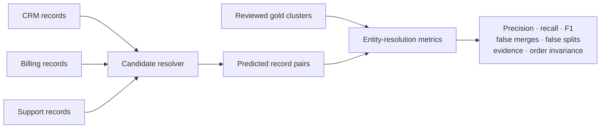

# Cross-Source Identity and Deduplication Benchmark v1

[Research boundary](../../../research/README.md) · [Evaluation metrics](../../../docs/evaluation_metrics.md) · [Generated report](../../../reports/cross_source_identity_benchmark.md)

This small synthetic benchmark tests whether entity-resolution techniques preserve source records while identifying cross-source co-reference. It deliberately includes aliases, legal suffixes, punctuation variants, repeated names, and one hard namesake.

The three source files contain no gold cluster labels. The separate gold fixture defines eight positive record pairs. In particular, two `Alex Kim` records refer to one person while a third refers to a different person; a name-only merge therefore creates false positives.

| Asset | Purpose |
| --- | --- |
| [`crm.csv`](crm.csv) | Four independent CRM organization and person records |
| [`billing.csv`](billing.csv) | Four billing records with aliases and the hard namesake |
| [`support.csv`](support.csv) | Four support records with repeated identities and one singleton |
| [`gold_entity_resolution.json`](gold_entity_resolution.json) | Reviewed record-to-cluster judgments used to derive eight positive pairs |
| [`benchmark_manifest.yaml`](benchmark_manifest.yaml) | Dataset identity, version, source inventory, provenance, limitations, and hard gates |
| [`generate_cross_source_identity_benchmark.py`](../../../scripts/generate_cross_source_identity_benchmark.py) | Versioned alias rules, evaluated baselines, configuration hash, evaluation, and report generation |



Run and publish the benchmark with:

```bash
make cross-source-identity-benchmark
```

The command regenerates semantically stable Markdown, CSV, and JSON results under [`reports/`](../../../reports/README.md). Dataset, configuration, generator, evaluated source tree, and result hashes identify the logical run; Git state and environment fields may legitimately differ between machines. A baseline may appear in the table even when it fails a correctness gate. Gate failure is a benchmark result, not a report-generation failure.

## Interpretation

| This fixture is suitable for | This fixture is not suitable for |
| --- | --- |
| Gold-fixture wiring and pairwise metric regression | Production model selection |
| False-merge and false-split accounting | Performance or scalability claims |
| Evidence coverage and source-order invariance | Field survivorship or temporal-update evaluation |
| Reproducible report generation | Proof that a learned resolver generalizes |

This committed fixture is intentionally small. Its generated leaderboard is research evidence, not a construction schema or release certificate.
