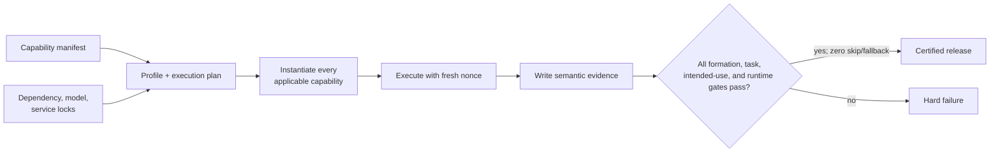

# Mandatory locked-artifact certification

Certification is the release-authorizing boundary for this repository. `convert(...)` returns draft graphs and metrics for inspection; draft output, research rankings, mocked providers, imported packages, and pre-authored reports are not certification evidence.

[Project overview](../README.md) · [Getting started](../docs/getting_started.md) · [Configuration](../docs/configuration.md) · [Testing guide](../docs/testing_guide.md) · [Evaluation metrics](../docs/evaluation_metrics.md)

## Pass contract

A release passes only when all six capability sets are identical and both exceptional execution counts are zero:

```text
declared = configured = instantiated = executed = evaluated = passed
skipped = 0
fallback = 0
```

[`scripts/certify.py`](../scripts/certify.py) dispatches every capability under a fresh run nonce; it does not accept a pre-authored report as trusted input.



The product being certified consists of structured construction, unstructured construction, and evaluation. Their canonical namespaces are `kg_construction.structured`, `kg_construction.unstructured`, and `kg_construction.evaluation`.

## Mandatory profiles

| Profile | Required accelerator | Mandatory provider and graph surface |
| --- | --- | --- |
| `darwin-arm64` | Torch MPS and MLX | GLiNER NER and RelEx, Transformers NER and Qwen3, spaCy, Qwen3 through MLX and Ollama, embedding and cross-encoder identity, declared external reconciliation, Neo4j, Memgraph, and Ladybug |
| `linux-cpu` | Torch CPU | The same mandatory surface except Darwin-only MLX and MPS |
| `linux-cuda` | Torch CUDA; CPU fallback fails certification | The same mandatory surface except Darwin-only MLX and MPS |

The Qwen generation family is consistent across runtimes: `Qwen/Qwen3-1.7B`, `mlx-community/Qwen3-1.7B-4bit`, and `qwen3:1.7b-q4_K_M`.

> **Applicability is not skipping.** MLX is mandatory for `darwin-arm64`; it is platform-inapplicable for Linux profiles and therefore absent from their declared capability set.

## Immutable inputs

| Human-authored source | Generated lock | What the lock freezes |
| --- | --- | --- |
| [`pyproject.toml`](../pyproject.toml) | [`uv.lock`](../uv.lock) | Python packages and transitive dependencies |
| [`models.manifest.yaml`](../models.manifest.yaml) | [`models.lock.yaml`](../models.lock.yaml) | Model revisions, per-file SHA-256 values and sizes, Ollama content digest, and unique byte totals |
| [`services.yaml`](services.yaml) | [`services.lock.yaml`](services.lock.yaml) | Docker Compose services using `repository@sha256:digest` image references |

Both generated model and service locks include a SHA-256 of their human-authored source, so editing a manifest invalidates its lock. Disk planning uses resolved unique snapshot and Ollama byte totals rather than duplicated per-profile rows.

Lock generation is the explicit online maintainer operation:

```bash
make release-locks
```

[`scripts/lock_models.py`](../scripts/lock_models.py) always locks every profile; it has no partial-profile mode. It also pulls a missing mandatory Ollama model before recording its digest. The operation can be large because GLiNER, GLiNER RelEx, Transformers, sentence-transformers, spaCy, Qwen3, and Darwin MLX artifacts are mandatory.

## Provision and certify

Provision all locked dependencies, models, and services:

```bash
make setup
```

Validate the selected profile without executing the final capability plan:

```bash
make certify-preflight
```

Execute the complete hard pass:

```bash
bash run_all_approaches.sh
```

| Command | Purpose | Network posture |
| --- | --- | --- |
| `make release-locks` | Resolve and write every immutable lock | Online; may download large artifacts |
| `make setup` | Install locked dependencies, hydrate models, start services, and run the strict doctor | Uses the network only to provision missing locked artifacts |
| `make certify-preflight` | Validate locks, offline model availability, services, and capability contracts | Dependency and model registries disconnected |
| `bash run_all_approaches.sh` | Run quality, product verification, and every semantic certifier | Registries disconnected; declared live reconciliation endpoints remain reachable |

“Registry-disconnected” is intentionally narrower than “no network.” The certificate proves that package, Hugging Face model, Ollama-model, and container downloads do not occur during the run. Capabilities whose purpose is remote identity or reconciliation still call their live endpoints and fail when those endpoints are unavailable. Ollama, Neo4j, and Memgraph remain mandatory local services; Ladybug remains a mandatory embedded runtime.

## Service and evidence contracts

[`src/kg_construction/resources/service-runtime.env`](../src/kg_construction/resources/service-runtime.env) is the single locked local service contract. The [`Makefile`](../Makefile) includes it and [`run_all_approaches.sh`](../run_all_approaches.sh) exports it, so readiness, doctor, public construction, and every semantic certifier resolve the same Neo4j URI, user, password, database, Memgraph URI, Ollama URL, and Ollama model.

Conflicting legacy `KG_CERT_*` aliases or empty variables fail closed. The `neo4j/certification` credential belongs only to the local digest-pinned stack; it is not a production secret.

`openrefine_reconciler` exercises the OpenRefine Reconciliation API v0.2 batch protocol against `https://wikidata-reconciliation.wmcloud.org/en/api`. This is a live Wikimedia Cloud service check, not a probe of a local OpenRefine desktop application.

| Contract | Role |
| --- | --- |
| [`capability_manifest.yaml`](../capability_manifest.yaml) | Declares the mandatory product capability surface |
| [`execution_plan.yaml`](execution_plan.yaml) | Maps every mandatory capability to a real semantic certifier command |
| [`research_inventory.yaml`](research_inventory.yaml) | Records research and roadmap items without promoting them into the product contract |
| `KG_CERT_RUN_ID` | Fresh nonce supplied to each certifier |
| `KG_CERT_EVIDENCE_PATH` | Per-capability path for semantic execution evidence |

[`execution_plan.yaml`](execution_plan.yaml) must contain a real certifier command for every mandatory row under `techniques` in [`capability_manifest.yaml`](../capability_manifest.yaml). Missing contracts, stale evidence, non-zero commands, missing stage evidence, skips, and fallbacks are hard failures. Repository artifact inventories are checked separately; listing a research report or notebook never turns it into product execution evidence.

The plan is intentionally not populated with weak import-only checks. A capability without a semantic certifier prevents certification.

## What certification does not include

`kg_construction.research` owns technique ranking, deterministic leaderboards, synthetic cross-source comparisons, Graph ML experiments, and mocked-provider demonstrations. Run them with `make research-smoke`, but keep these distinctions:

| Research artifact or judgment | Why it cannot authorize publication |
| --- | --- |
| Weighted technique ranking | A composite score cannot override a mandatory formation, extraction, schema, runtime, or intended-use failure |
| Synthetic cross-source comparison | Leaderboard rank cannot replace explicit false-merge and false-split gates |
| Retrieval relevance judgment | It is evaluated only as a declared intended-use input |
| Mocked provider demonstration | It proves interface behavior, not live provider execution |

The term `Claim` in unstructured evidence refers to a reified, evidence-grounded semantic assertion. Certification evaluates assertion content, intent, qualifiers, evidence, and provenance; it does not certify a business “claims” domain.

See the [research boundary](../research/README.md) and [reports guide](../reports/README.md) for artifact ownership.
