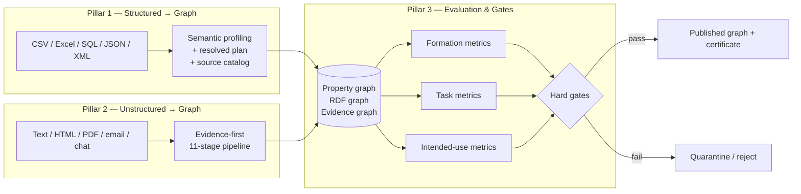
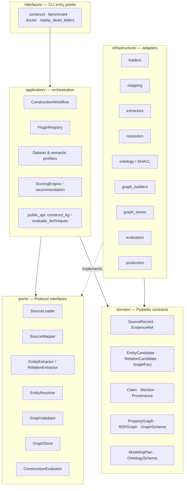
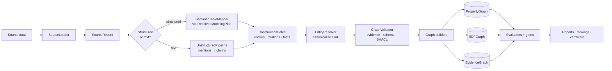
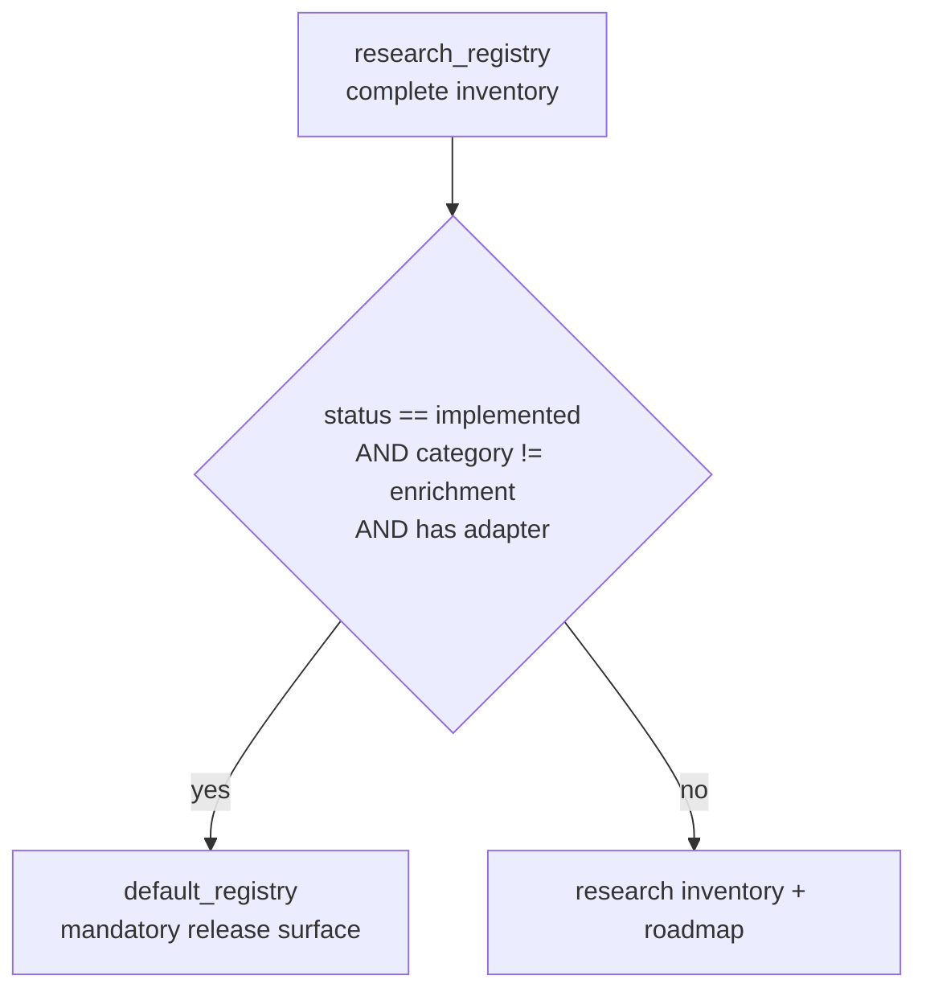
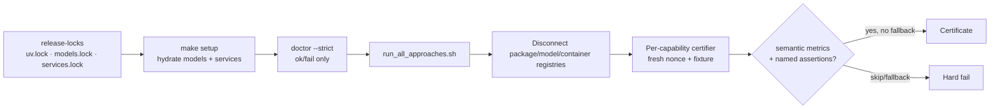

# Repository architecture

`kg_construction` is a **hexagonal (ports-and-adapters)** framework for turning
structured and unstructured data into evidence-grounded knowledge graphs. The
design goal is that the *shape of the graph* — identities, relationships,
provenance — is decided by an inner domain contract, and every external
technology (a loader, an NER model, Neo4j, RDF, a metric) is a replaceable
adapter behind a small protocol.

This document is the map. The technique write-ups drill into each layer:

- [Structured data → KG techniques](techniques_structured_to_kg.md)
- [Unstructured data → KG techniques](techniques_unstructured_to_kg.md)
- [Evaluation metrics, weighting, and thresholds](evaluation_metrics.md)
- [Testing every technique](testing_guide.md)
- [Modelling doctrine and stage gates](knowledge_graph_modelling.md)

---

## 1. The three pillars

Everything in the repo serves one of three product pillars. Storage (Neo4j, RDF,
Memgraph, Ladybug, vector indexes) is treated as a *projection* of a correctly
formed model — it cannot repair identities or relationships that were formed
wrong.



| Pillar | Question it answers | Canonical modules |
| --- | --- | --- |
| 1. Structured → graph | Are entities identified once and related correctly, with no duplicated literals? | `application/semantic_profiler.py`, `application/resolved_plan.py`, `application/source_catalog.py`, `application/semantic_table_mapper.py` |
| 2. Unstructured → graph | Is every promoted claim backed by an exact span and complete provenance? | `application/unstructured_pipeline.py`, `domain/claim.py`, `infrastructure/extractors/model_backed/` |
| 3. Evaluation & gates | Is the graph intrinsically well-formed *and* fit for its declared use? | `infrastructure/evaluation/`, `application/scoring.py`, `certification/` |

---

## 2. Hexagonal layers

The package is split into four rings. Dependencies point **inward** only: the
domain knows nothing about Neo4j or GLiNER; adapters depend on the ports; the
application layer orchestrates.



| Layer | Directory | Responsibility | Depends on |
| --- | --- | --- | --- |
| Domain | `src/kg_construction/domain/` | Immutable Pydantic models and modelling contracts; no I/O | nothing |
| Ports | `src/kg_construction/ports/` | `Protocol` interfaces (loader, mapper, extractor, resolver, validator, store, evaluator, enricher) | domain |
| Application | `src/kg_construction/application/` | Workflow orchestration, registry, profiling, scoring, public API | domain, ports |
| Infrastructure | `src/kg_construction/infrastructure/` | Concrete adapters for every external technology | domain, ports |
| Interfaces | `src/kg_construction/interfaces/cli/` | `construct`, `benchmark`, `doctor`, `replay_dead_letters` console scripts | application |

---

## 3. Core data flow

The same domain vocabulary flows through both pillars. A source becomes
`SourceRecord`s, which produce `EvidenceRef`-carrying candidates, which are
resolved, validated, and materialized into three graph views.



Key domain objects (`domain/models.py`, `domain/claim.py`,
`domain/graph_objects.py`, `domain/modeling.py`):

| Object | Role |
| --- | --- |
| `SourceRecord` | One immutable loaded record with a content-derived identity |
| `EvidenceRef` | Exact span/selector + source id + extractor metadata that backs any candidate |
| `EntityCandidate` / `RelationCandidate` / `GraphFact` | Extraction observations before promotion |
| `Claim` / `Mention` / `Provenance` / `TextSpan` | The reified, evidence-bound unstructured contract |
| `ConstructionBatch` | The bundle handed between workflow stages |
| `ModelingPlan` → `ResolvedModelingPlan` | Proposed then resolved column semantics for structured data |
| `OntologySchema` | The single source projected into 6 schema artifacts |
| `PropertyGraph` / `RDFGraph` / `EvidenceGraph` | The three materialized graph views |

---

## 4. The technique registry

The framework is *technique-centered*: many construction techniques are
registered side by side, then ranked and recommended. Two registry views exist
(`application/registry.py`):



| Registry view | Count (live) | Meaning |
| --- | ---: | --- |
| `research_registry()` total | 165 | Every implemented, adapter, and roadmap entry — comparative research surface |
| — implemented | 123 | Working technique with a class |
| — adapter | 15 | Wraps an external tool; kept for comparison |
| — stub | 27 | Roadmap extension point, not executable |
| `default_registry()` | 105 | Mandatory, certifiable release capabilities only |

Public maturity labels (via `TechniqueDescriptor.public_support_label`):
**Mandatory 96 · Research inventory 42 · Roadmap 27**.

Registered categories (research view): `loader` (20), `mapper` (25),
`extractor` (27), `resolution` (16), `enrichment` (24), `validation` (9),
`graph_store` (9), `production` (9), `schema` (8), `hybrid` (8), `evaluation`
(6), `graph_builder` (3), `llm` (1).

> Counts drift as the code evolves — reproduce them with
> `make registry-reports` or the `Counter` snippet in
> [testing_guide.md](testing_guide.md).

---

## 5. The mandatory "hard pass" (certification)

The release contract is **zero-skip**: a capability is credited only when
`declared = configured = instantiated = executed = evaluated = passed`.
Importability alone earns nothing.



| Artifact | Produced by | Purpose |
| --- | --- | --- |
| `uv.lock` | `uv lock` | Every Python distribution pinned |
| `models.lock.yaml` | `scripts/lock_models.py` | Model commit + per-file SHA-256 + device + license |
| `certification/services.lock.yaml` | `scripts/lock_service_digests.py` | Container images by immutable digest |
| `capability_manifest.yaml` | `scripts/generate_capability_manifest.py` | Registry ↔ owner bijection, doctrine split |
| `certification/execution_plan.yaml` | maintained | Per-capability semantic certifier contract |

Model/platform profiles live in `models.manifest.yaml`: `darwin-arm64` (MPS +
MLX), `linux-cpu`, `linux-cuda`. Each profile mandates GLiNER, Transformers,
spaCy, sentence-transformers, Qwen3 (Transformers + Ollama, plus MLX on Apple
Silicon), and the Ollama/Neo4j/Memgraph/Ladybug services.

---

## 6. Where to find things

```text
src/kg_construction/
  domain/           models, claim, graph_objects, modeling, normalization, schema, evidence
  ports/            loaders, mappers, extractors, resolvers, validators, graph_store, evaluators, enrichers
  application/      workflow, registry, semantic_profiler, resolved_plan, source_catalog,
                    semantic_table_mapper, plan_resolution, scoring, recommendation_engine,
                    benchmark_runner, public_api, unstructured_pipeline, modelling_correctness
  infrastructure/
    loaders/        csv, json, text, excel, sql, api, xml, pdf, email, chat, html, log, ...
    mapping/        direct_table, semi_structured (JSONPath), standards (R2RML/RML/CSVW/JSON-LD/OBDA)
    extractors/     regex, gazetteer, relations, ollama_graph, gliner; model_backed/ (ensembles)
    resolution/     exact, canonicalization, entity_resolution, linking, mandatory_ensemble
    ontology/       schema_proposal, structured_ontology, shacl, ontology_alignment, unstructured_governance
    graph_builders/ property_graph, rdf_graph, evidence_graph
    graph_stores/   neo4j/vector, memgraph, ladybug, networkx, rdf exporters + ingestion
    evaluation/     metrics, accuracy, coverage, validation, entity_resolution, retrieval,
                    schema_quality, intended_use_metrics, quality_gates, claim_evaluations, graph_bound_suite
    production/     logging, manifests, watermarks, retry, dead_letter, quarantine, review, pii
  interfaces/cli/   construct, benchmark, doctor, replay_dead_letters
  certification/    runner, execution, capabilities, profiles, preflight
```
