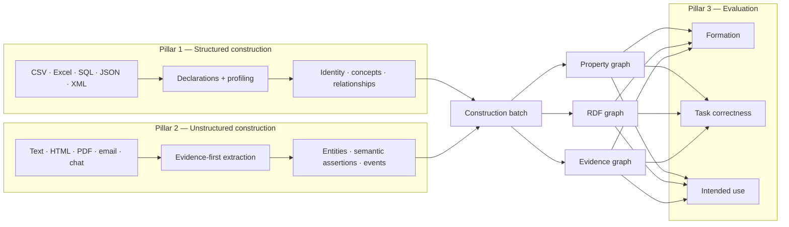
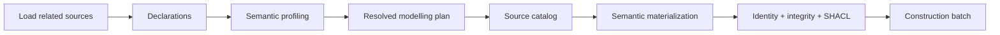
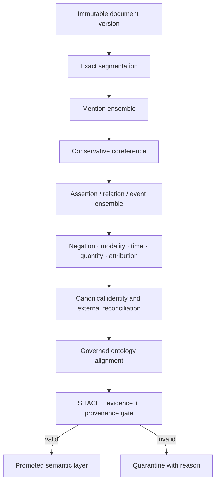
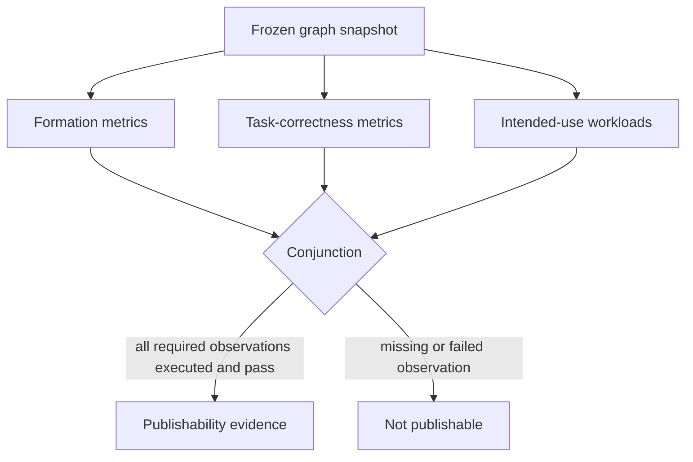
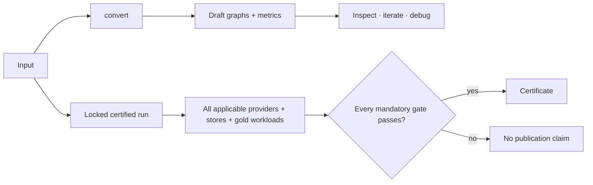
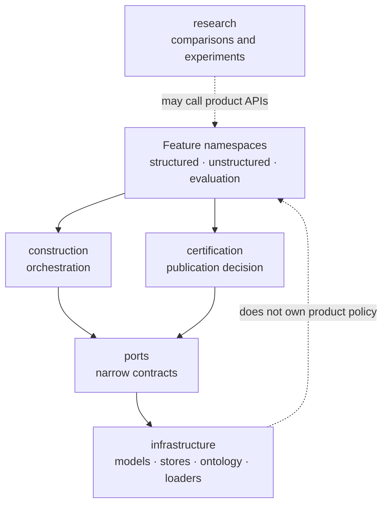

# Repository architecture

[Documentation home](README.md) / Repository architecture

`kg_construction` is organized around graph-construction outcomes, not databases or model vendors. This page explains where each responsibility lives, how data moves between the three product pillars, and where to add new implementations.

> **Architecture in one sentence:** structured and unstructured sources produce the same evidence-bearing construction contracts; evaluation decides whether their graph projections are fit for use.

If you are new to the repository, read this page first, continue with the [formation and evaluation contract](knowledge_graph_modelling.md), and then choose the [structured](techniques_structured_to_kg.md) or [unstructured](techniques_unstructured_to_kg.md) technique guide.

The public feature boundaries are:

```text
kg_construction.structured
kg_construction.unstructured
kg_construction.evaluation
kg_construction.research
```

The first three namespaces are the product. `research` contains non-authoritative comparison and experimentation surfaces.

**On this page:** [product pillars](#1-product-pillars) · [shared contracts](#2-shared-semantic-contracts) · [structured flow](#3-structured-flow) · [unstructured flow](#4-unstructured-flow) · [evaluation](#5-evaluation-flow) · [draft versus publishable](#6-draft-versus-publishable-execution) · [runtime boundaries](#7-runtime-boundaries) · [research boundary](#8-research-boundary)

## 1. Product pillars



| Pillar | Governing question | Canonical namespace |
| --- | --- | --- |
| Structured | Are real things identified once, governed categories shared, and relationships formed from declared structure? | `kg_construction.structured` |
| Unstructured | Are entities, intent, qualifiers, and relations preserved with exact evidence and provenance? | `kg_construction.unstructured` |
| Evaluation | Is the graph both well formed and fit for its declared consumer? | `kg_construction.evaluation` |

Stores are projections. Neo4j, Memgraph, Ladybug, RDF, NetworkX, and vector indexes do not decide identity or repair construction errors.

## 2. Shared semantic contracts

Both construction pillars converge on common immutable contracts:

| Contract | Meaning |
| --- | --- |
| `SourceRecord` | One versioned source record or document |
| `EvidenceRef` / `TextSpan` | Exact source selector that supports an observation |
| `EntityCandidate` | Observed entity before canonical resolution |
| `RelationCandidate` / `GraphFact` | Evidence-backed candidate relationship or fact |
| `Mention` | One textual occurrence |
| `Claim` | Evidence-grounded semantic assertion, including qualifiers and provenance |
| `ConstructionBatch` | The observations passed to validation and graph builders |
| `ResolvedModelingPlan` | The construction-ready structured schema contract |
| `PropertyGraph` / `RDFGraph` / `EvidenceGraph` | Consistent views of one batch |

`Claim` is a technical representation, not a business domain. It remains reified until negation, modality, time, quantity, attribution, and event roles are safely preserved. A convenient direct edge may then be projected alongside it.

The [modelling doctrine](knowledge_graph_modelling.md#modelling-doctrine) defines the invariants shared by these contracts.

## 3. Structured flow



The structured boundary owns:

- declared primary, alternate, and composite keys;
- source/global/cross-source identity scope;
- role and materialization decisions per column;
- controlled-vocabulary schemes and canonicalization;
- foreign-key target resolution;
- association/event reification; and
- agreement among property-graph, RDF, JSON-LD, OWL, SHACL, Neo4j, and evaluation projections.

Profiling can propose missing semantics, but its confidence remains visible. Missing foreign-key targets are retained as unresolved source values and never fabricated as nodes.

See [Structured data → knowledge graph](techniques_structured_to_kg.md) for the techniques, decision rules, and mapper selection guide.

## 4. Unstructured flow



The certified mention ensemble runs deterministic patterns, GLiNER, Transformers NER, and spaCy. The certified assertion ensemble runs deterministic patterns, GLiNER RelEx, Qwen3 through Transformers and Ollama, and Qwen3 through MLX on Apple Silicon. Embedding, cross-encoder, and declared external identity providers also execute.

Every platform-applicable provider is mandatory during certification. Provider disagreement is retained as evidence; provider failure fails the certified stage.

See [Unstructured data → knowledge graph](techniques_unstructured_to_kg.md) for the identity layers, provider ensembles, and promotion gate.

## 5. Evaluation flow

Evaluation is not a single aggregate score:



- **Formation** measures identity, conciseness, integrity, evidence, provenance, completeness, SHACL, and idempotence.
- **Task correctness** measures extraction, identity resolution, joins, schema, and qualifier preservation against reviewed judgments.
- **Intended use** executes SQL-like, NoSQL, GraphRAG, vector, link-prediction, recommendation, and reasoning workloads against the same frozen graph.

`relevance` and `context_relevance` are expected judgments for retrieval metrics. They do not influence construction identity or schema.

All product evaluator implementations are owned by `kg_construction.evaluation`. Modules under `kg_construction.infrastructure.evaluation` are named, identity-preserving compatibility shims for legacy imports; neither package uses a wildcard façade. This keeps runtime adapters in infrastructure without assigning evaluation policy or metric ownership to that layer.

The complete metric definitions, thresholds, and intended-use workloads are documented in [Evaluation metrics](evaluation_metrics.md).

## 6. Draft versus publishable execution



`convert(...)` is total: it returns a draft graph and observations so a user can inspect failures. It does not make the graph publishable.

Certification selects one immutable platform profile, validates dependency, model, and service locks, dispatches each mandatory capability with fresh evidence, and requires:

```text
declared = configured = instantiated = executed = evaluated = passed
skipped = 0
fallback = 0
```

## 7. Runtime boundaries

Two supporting namespaces compose and verify the product without becoming extra pillars:

| Supporting namespace | Responsibility |
| --- | --- |
| `kg_construction.construction` | Root `convert(...)` orchestration and draft result assembly |
| `kg_construction.certification` | Immutable runtime selection, semantic execution evidence, and the publication decision |

External systems remain behind narrow interfaces, while every profile-applicable implementation remains mandatory for certification:

- ports define loader, mapper, extractor, resolver, validator, evaluator, and graph-store behavior;
- runtime implementations connect GLiNER, Transformers, spaCy, MLX, Ollama, Neo4j, Memgraph, Ladybug, RDF, and external reconciliation;
- the selected certification profile determines applicability; and
- every applicable implementation must execute.

The physical compatibility layers (`domain/`, `ports/`, `application/`, `infrastructure/`, and `interfaces/`) may remain during migration. New user-facing imports and documentation should use the feature namespaces so structured, unstructured, evaluation, and research responsibilities remain obvious.



## 8. Research boundary

`kg_construction.research` may contain:

- simple candidate-graph benchmarks;
- weighted technique comparison;
- deterministic leaderboard fixtures;
- synthetic cross-source identity comparisons;
- Graph ML enrichment experiments;
- dataset experiments; and
- mocked provider demonstrations.

Research output is never a certificate. A high research rank cannot override a duplicate identity, unsupported assertion, SHACL violation, missing provider, or failed intended-use workload.

Cross-source identity itself remains a core modelling concern. The *leaderboard* comparing cross-source resolvers is research; false-merge and false-split metrics remain core evaluation.

## 9. Where to go next

| Goal | Read next |
| --- | --- |
| Understand the invariants and release gates | [Knowledge-graph formation and evaluation contract](knowledge_graph_modelling.md) |
| Build a graph from tables, JSON, XML, or declared mappings | [Structured construction techniques](techniques_structured_to_kg.md) |
| Build an evidence-grounded graph from text | [Unstructured construction techniques](techniques_unstructured_to_kg.md) |
| Understand every metric and intended-use workload | [Evaluation metrics](evaluation_metrics.md) |
| Run the project for the first time | [Getting started](getting_started.md) |
| Configure sources, models, stores, and gates | [Configuration](configuration.md) |
| Run unit, integration, smoke, and quality checks | [Testing guide](testing_guide.md) |
| Understand the zero-skip publication decision | [Certification](../certification/README.md) |
