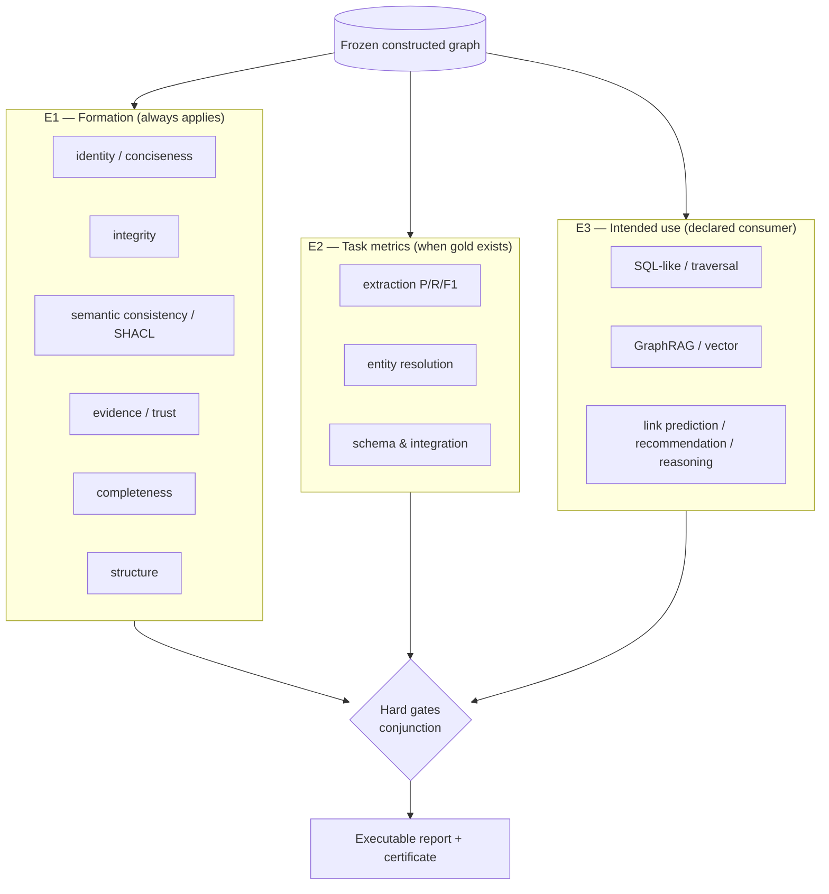
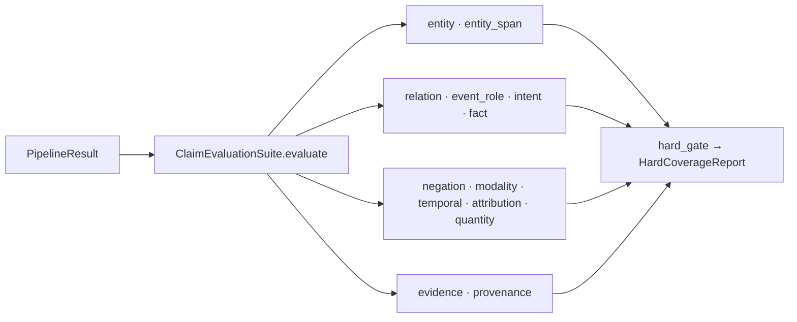
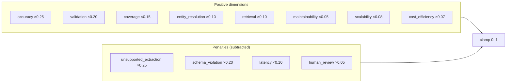
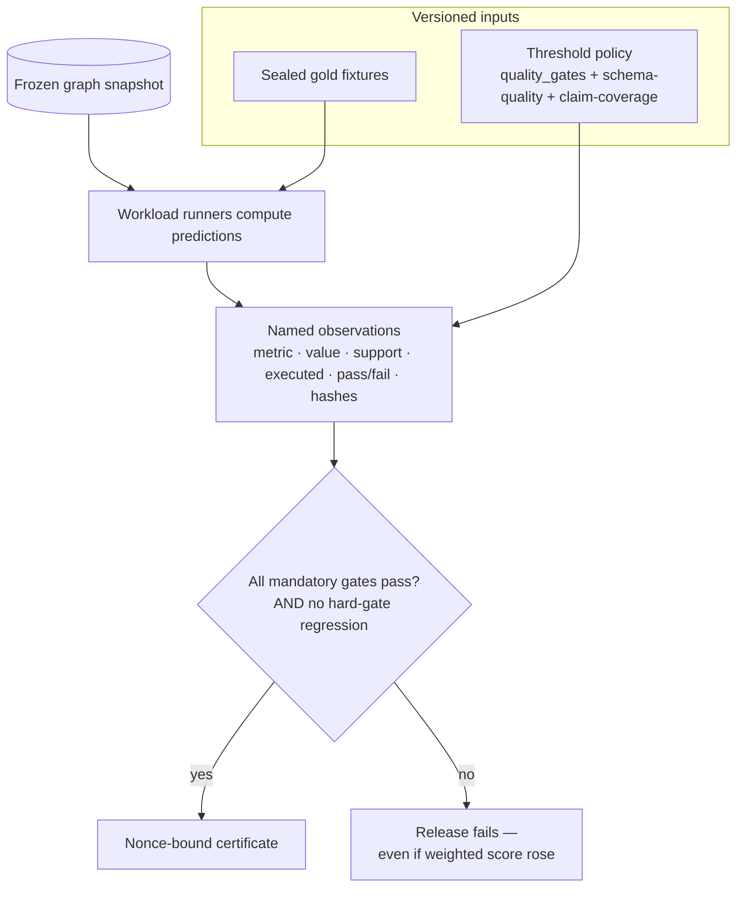

# Evaluation: metrics, weighting, and thresholds

This is the technical reference for **Pillar 3**. It answers four questions for
every metric the repo computes:

- **What** it measures
- **Why** that evaluation is required
- **How** it is calculated (the exact formula)
- **What threshold** decides pass/fail, and **how** metrics combine into a final
  decision

The single most important design rule: **a weighted score can rank research
candidates, but it can never override a correctness gate.** The release result is
the *conjunction of mandatory gates*. "Not measured" is a gate failure, never a
passing zero.

Contents:

1. [The three evaluation tiers](#1-the-three-evaluation-tiers)
2. [Why separate intrinsic quality from fitness-for-use](#2-why-separate-intrinsic-quality-from-fitness-for-use)
3. [Tier E1 — universal formation metrics](#3-tier-e1--universal-formation-metrics)
4. [Tier E2 — task metrics](#4-tier-e2--task-metrics)
5. [Tier E3 — intended-use metrics](#5-tier-e3--intended-use-metrics)
6. [The unstructured claim evaluation suite](#6-the-unstructured-claim-evaluation-suite)
7. [The schema-quality evaluator](#7-the-schema-quality-evaluator)
8. [The weighted scoring engine (research ranking)](#8-the-weighted-scoring-engine-research-ranking)
9. [The complete threshold table](#9-the-complete-threshold-table)
10. [How a release decision is assembled](#10-how-a-release-decision-is-assembled)

---

## 1. The three evaluation tiers



| Tier | Applies when | Owning modules | Nature |
| --- | --- | --- | --- |
| E1 Formation | always | `metrics.py`, `validation_metrics.py`, `coverage_metrics.py`, `quality_gates.py` | Intrinsic hard gates |
| E2 Task | a gold fixture is declared | `accuracy_metrics.py`, `entity_resolution_metrics.py`, `claim_evaluations.py`, `schema_quality.py` | Supervised P/R/F1 |
| E3 Intended use | a consumer is declared | `intended_use_metrics.py`, `graph_bound_suite.py`, `retrieval_metrics.py` | Downstream fitness |

---

## 2. Why separate intrinsic quality from fitness-for-use

A graph can be internally perfect (no dangling edges, full evidence) and still
useless for its consumer — or answer queries adequately while silently
duplicating entities. Following [Steps to KG Quality
Assessment](https://arxiv.org/abs/2208.07779) and
[KGrEaT](https://arxiv.org/abs/2308.10537), the repo evaluates **both**, and
never lets one substitute for the other. This also prevents a *circular
benchmark*: expected judgments are versioned **inputs**, while predictions are
computed by workload runners from the frozen graph and are **never accepted from
the caller** (`construct_kg` refuses caller-supplied predictions in the
evaluation suite).

The evidence model deliberately mirrors the [W3C Data Quality
Vocabulary](https://www.w3.org/TR/vocab-dqv/): the versioned threshold set is the
**policy**, each named observation is a **measurement**, and the nonce-bound
hard-pass report is the **certificate**.

---

## 3. Tier E1 — universal formation metrics

These apply before any downstream benchmark. Computed by
`ConstructionMetricsEvaluator` (`metrics.py`) and `ValidationMetrics`
(`validation_metrics.py`).

| Dimension | Metric | How it is calculated | Ideal threshold |
| --- | --- | --- | ---: |
| identity / conciseness | `categorical_duplication_rate` | fraction of dimension values materialized as repeated literals rather than one shared node | `= 0` |
| | `duplicate_node_rate` | `1 − distinct(key)/count(nodes)` within a class | `= 0` |
| | `literal_that_should_be_node_rate` | literals matching a promoted-dimension value | `= 0` |
| integrity | `dangling_edge_rate` | edges whose source or target node id is absent ÷ edges | `= 0` |
| | `duplicate_edge_rate` | `1 − distinct(qualifier-aware key)/count(edges)` | `= 0` |
| | `referential_integrity_score` | `1 − dangling_edge_rate` | `= 1` |
| | `orphan_node_rate` | domain nodes with no edge ÷ domain nodes | `≤ 0.05` |
| evidence / trust | `evidence_coverage` | candidates whose evidence has source_id + location ÷ candidates | `= 1` |
| | `provenance_coverage` | candidates with evidence **and** extractor_name **and** technique ÷ candidates | `= 1` |
| | `exact_evidence_coverage` | claims whose spans exactly quote the source ÷ claims | `= 1` |
| | `unsupported_extraction_rate` | candidates lacking any source-backed evidence ÷ candidates | `= 0` |
| completeness | `source_coverage` | sources that contributed ≥1 candidate ÷ sources | `= 1` |
| consistency | `shacl_executed` | did SHACL actually run? | `= 1` (true) |
| | `shacl_violation_count` | pySHACL violations against the generated RDF | `= 0` |

**Why each matters**

- *Conciseness* is the whole point of Pillar 1 — a duplicated categorical literal
  is the failure the semantic mapper exists to prevent.
- *Integrity* — a dangling or duplicate edge silently corrupts every traversal
  and aggregation downstream.
- *Evidence/trust* — an unsupported promoted claim is indistinguishable from a
  hallucination; requiring exact spans + provenance makes every fact auditable.
- *`shacl_executed` as its own gate* — this closes the "passing zero" hole: a
  schema-quality report is not allowed to pass unless SHACL actually ran
  (a null violation count can no longer masquerade as conformance).

The base precision/recall/F1 helper is zero-safe:

```
precision = TP / predicted      (0 if predicted == 0)
recall    = TP / expected       (0 if expected == 0)
F1        = 2·P·R / (P + R)      (0 if P + R == 0)
```

---

## 4. Tier E2 — task metrics

### 4.1 Extraction accuracy (`accuracy_metrics.py`)

Counts **occurrences** (not sets), so repeated mentions are not collapsed, and
scores entities, exact spans, and relations *separately*.

| Metric | Match key | Why separate |
| --- | --- | --- |
| `entity_f1` | `(source, version, type, casefolded surface)` | name/type correctness |
| `span_f1` | `(source, version, start, end, type)` | exact boundary correctness — a boundary error cannot hide behind entity F1 |
| `relation_f1` | `(subject endpoint, predicate, object endpoint, qualifiers)` | direction + qualifier-aware; negation/modality/time/quantity/role are part of the key |
| `triple_exact_match` / `relaxed_triple_match` | derived from relation F1 | strict vs relaxed triple scoring |

Ideal thresholds (`quality_gates.py`, `ner`/`relation` families): F1 `≥ 0.80`,
gold coverage `≥ 0.80`, gold and prediction support `≥ 1`.

### 4.2 Entity resolution (`entity_resolution_metrics.py`)

Merge decisions are turned into **pairs** grouped by `canonical_entity_id`, then
compared against gold pairs over a shared record-ID universe.

| Metric | Formula | Ideal |
| --- | --- | ---: |
| `pairwise_er_f1` / `cluster_f1` | P/R/F1 over predicted vs gold merge pairs | `≥ 0.80` |
| `false_merge_rate` | `|predicted − gold| / |predicted|` | `→ 0` |
| `false_split_rate` | `|gold − predicted| / |gold|` | `→ 0` |
| `er_record_id_overlap_rate` | `|overlap| / |gold ids|` | records must be comparable |

If the predicted and gold record-ID universes are **disjoint**, the evaluator
raises — a benchmark you cannot compare must fail loudly, not score 0.

### 4.3 Schema & integration

Key/datatype preservation, foreign-key/join accuracy, association qualifier
preservation, source-field coverage, and structured round-trip query
correctness — all `= 1.0` gold gates (see `structured` family below).

---

## 5. Tier E3 — intended-use metrics

**File:** `intended_use_metrics.py`. The *same frozen graph* is evaluated for
each declared consumer. Reports are **graph-bound**: an executed benchmark must
carry graph + fixture hashes, one query hash and one observed latency per case,
and per-family workload support — an unexecuted benchmark cannot publish cases,
metrics, or a pass (`_execution_state_is_honest` enforces this).

| Intended use (`IntendedUse`) | Required metrics | Notes / ideal |
| --- | --- | --- |
| `sql_like` | query success, result precision/recall, aggregation accuracy, p50/p95 latency | `competency_question_accuracy ≥ 0.80`; latency vs declared `max_p95_latency_ms` |
| `nosql` | path-answer accuracy, traversal coverage, fan-out/latency, read/write correctness | exact traversal result |
| `graphrag` | Recall@k, MRR, nDCG, path relevance, multi-hop success, answer faithfulness, citation accuracy | judged per-stage ([GraphRAG-Bench](https://arxiv.org/abs/2506.02404), [MultiHop-RAG](https://arxiv.org/abs/2401.15391)) |
| `vector` | index coverage, Recall@k, MRR, nDCG, ANN latency/memory, filtered-retrieval correctness | `vector_recall_at_k ≥ 0.70`; recall is *measured*, not inferred from index availability |
| `link_prediction` | filtered MRR and Hits@k, by popularity stratum | default `min_filtered_hits_at_k = {1:0.10, 3:0.20, 10:0.30}`; stratified because [popularity biases KGE metrics](https://proceedings.mlr.press/v124/mohamed20a.html) |
| `recommendation` | Precision/Recall/nDCG@k, catalog coverage, novelty, intra-list diversity | plus `max_p95_runtime_ms` |
| `reasoning` | competency-question accuracy, inferred-fact precision/recall, rule consistency, runtime | `max_p95_runtime_ms` |

**Popularity stratification** (`PopularityStratumReport`) reports MRR and Hits@k
separately for **head / torso / tail** entities, so a model that only ranks
popular entities cannot look good on aggregate.

---

## 6. The unstructured claim evaluation suite

**File:** `claim_evaluations.py` · **Registry:** `claim_evaluation_suite`

Runs **every** held-out metric on every invocation — there is no "not evaluated"
success state. Each returns a full `EvalScore` (precision, recall, F1, gold /
predicted / matched counts).



| Metric group | What it scores | How |
| --- | --- | --- |
| `entity`, `entity_span` | canonical entity + exact mention span | set P/R/F1 vs gold entities / gold mentions |
| `relation`, `event_role`, `intent`, `fact` | typed claim signatures | signature = `(canonical subject, predicate, canonical object)`; events use `(predicate, role, filler)` |
| `negation`, `modality`, `temporal`, `attribution`, `quantity` | qualifier agreement on **aligned** claims | recall is over *all* gold claims so a missed relation can't inflate qualifier accuracy |
| `evidence` | claims quoting the source exactly | `has_exact_evidence(text)` ÷ claims |
| `provenance` | claims with complete provider/model provenance | `has_complete_provenance(text)` ÷ claims |

**Ideal thresholds** (`HardCoverageThresholds`) — the release fixture demands a
perfect result:

| Threshold | Default |
| --- | ---: |
| every metric F1 (entity, span, relation, event_role, intent, fact, negation, modality, temporal, attribution, quantity, evidence, provenance) | `≥ 1.0` |
| `claim_coverage` (matched semantic units ÷ gold units) | `≥ 1.0` |
| `maximum_unsupported_claim_rate` ((predicted − matched) ÷ predicted) | `≤ 0.0` |

A required metric missing from the suite is itself a gate failure.

---

## 7. The schema-quality evaluator

**File:** `schema_quality.py` · **Registry:** `schema_quality_evaluator` ·
version `schema-quality-v2`

Profiles the graph across **four dimensions** and gates a release. Categorical
duplication is *policy-aware*: only columns the policy promotes to nodes are
checked, so a value kept as a property by the supernode guard is not wrongly
flagged.

| Dimension | Metrics | Gate (default) |
| --- | --- | --- |
| conciseness | `categorical_duplication_rate`, `literal_that_should_be_node_rate`, `duplicate_node_rate`, `categorical_source_occurrence_coverage` | dup rate `≤ 0`; node dup `≤ 0`; occurrence coverage `≥ 1.0` |
| completeness | `schema_completeness`, `property_completeness`, `relationship_completeness`, `class_population` | property & relationship completeness `≥ 1.0` |
| consistency | `domain_range_violation_rate`, `cardinality_violation_rate`, `consistency_violation_count`, `shacl_violation_count`, `shacl_executed` | consistency violations `≤ 0`; **SHACL must have executed**; SHACL violations `≤ 0` |
| structure ([OntoQA](https://doi.org/10.1016/j.websem.2005.06.001)) | `node_count`, `edge_count`, `average_degree`, `orphan_rate`, `connected_component_count`, `class_richness`, `relationship_richness`, `attribute_richness` | orphan rate `≤ 0.05` |

`require_shacl_execution: Literal[True]` is a *type-level* invariant — the gate
cannot be constructed with SHACL disabled.

---

## 8. The weighted scoring engine (research ranking)

**File:** `application/scoring.py`. This produces the `final_score` used to
**rank techniques** in benchmarks and the leaderboard. It is explicitly *not* a
release gate — it helps compare candidates.

### The formula

```
FinalScore = clamp(  quality_positive − quality_negative
                   + runtime_positive − runtime_negative )
```



### Positive dimension weights (`ScoringWeights`, sum = 1.0)

| Dimension | Weight | How the dimension score is built |
| --- | ---: | --- |
| accuracy | 0.25 | mean of available gold F1s (entity, span, relation, triple, ER, retrieval); zero is a *measured* failure, not a missing value |
| validation | 0.20 | mean of 7: schema validity, RDF/SHACL validity, evidence coverage, provenance, `1−duplicate_edge`, `1−orphan`, `1−validation_failure` |
| coverage | 0.15 | mean of entity/relation/source/attribute coverage |
| entity_resolution | 0.10 | mean of pairwise F1, cluster F1, `1−false_merge`, `1−false_split` |
| retrieval | 0.10 | mean of Recall@k, path relevance, multi-hop success, citation accuracy, faithfulness |
| scalability | 0.08 | `scalability_score` or `1/(1+latency)` |
| cost_efficiency | 0.07 | `cost_efficiency_score` or `1/(1+cost_proxy)` |
| maintainability | 0.05 | `method_bonus × status_factor` (deterministic 1.0 … llm 0.55; implemented 1.0, adapter 0.75, stub 0.4) |

### Penalty weights (`PenaltyWeights`, subtracted)

| Penalty | Weight | Source |
| --- | ---: | --- |
| unsupported_extraction (a.k.a. hallucination) | 0.25 | `unsupported_extraction_rate` |
| schema_violation | 0.20 | `schema_violation_rate` or `1 − schema_validity` |
| latency | 0.10 | `latency_penalty` |
| human_review | 0.05 | `human_review_rate` |

### Production decision thresholds (`ProductionThresholds`)

Separate from the ranking score, these are the safe-to-ship cutoffs:

| Threshold | Value |
| --- | ---: |
| `evidence_coverage` | `≥ 0.95` |
| `schema_validity` | `≥ 0.95` |
| `unsupported_extraction_rate` (hallucination) | `≤ 0.02` |
| `validation_failure_rate` | `≤ 0.05` |

> The weighted score deliberately does **not** attach a statistical confidence
> interval (`confidence_interval_method = "not_estimated"`); a degenerate
> interval is never presented as uncertainty. Real intervals come from
> `statistical_confidence.py` (bootstrap for means, Wilson for proportions).

---

## 9. The complete threshold table

`quality_gates.py` holds the versioned, immutable gate set
(`VersionedQualityThresholds`; changing a threshold requires a new version).
Every family must be present or the threshold set is invalid.

| Family | Metric | Operator | Threshold |
| --- | --- | :---: | ---: |
| formation | evidence_coverage | ≥ | 1.0 |
| formation | provenance_coverage | ≥ | 1.0 |
| formation | exact_evidence_coverage | ≥ | 1.0 |
| formation | dangling_edge_rate | ≤ | 0.0 |
| formation | duplicate_edge_rate | ≤ | 0.0 |
| formation | unsupported_extraction_rate | ≤ | 0.0 |
| formation | source_coverage | ≥ | 1.0 |
| formation | validation_passed | ≥ | 1.0 |
| formation | constructed_object_support | ≥ | 1.0 |
| structured | property_completeness | ≥ | 1.0 |
| structured | relationship_completeness | ≥ | 1.0 |
| structured | consistency_violation_count | ≤ | 0.0 |
| structured | shacl_executed | ≥ | 1.0 |
| structured | shacl_violation_count | ≤ | 0.0 |
| structured | graph_object_support | ≥ | 1.0 |
| category | categorical_duplication_rate | ≤ | 0.0 |
| idempotence | graph_idempotence_score | ≥ | 1.0 |
| ner | entity_f1 | ≥ | 0.80 |
| ner | span_f1 | ≥ | 0.80 |
| ner | entity_gold_coverage | ≥ | 0.80 |
| ner | span_gold_coverage | ≥ | 0.80 |
| relation | relation_f1 | ≥ | 0.80 |
| relation | relation_gold_coverage | ≥ | 0.80 |
| coreference | coreference_b3_f1 | ≥ | 0.80 |
| linking | entity_linking_accuracy | ≥ | 0.80 |
| query | competency_question_accuracy | ≥ | 0.80 |
| vector | vector_recall_at_k | ≥ | 0.70 |
| operational | pipeline_success_rate | ≥ | 1.0 |
| operational | retry_rate | ≤ | 0.05 |

Interpretation of the two threshold bands:

- **`= 1.0` / `= 0.0` gates** are *correctness invariants* — formation,
  structured integrity, categorical conciseness, idempotence, SHACL. These must
  be exact; there is no partial credit.
- **`≥ 0.80` / `≥ 0.70` gates** are *supervised-quality floors* — NER, relation,
  coreference, linking, query, vector. These acknowledge that learned components
  are imperfect but must clear a meaningful bar, and every one requires
  `gold_support ≥ 1` so a "pass" can never be computed over an empty fixture.

---

## 10. How a release decision is assembled



Each observation records: metric + purpose, value + support count, threshold +
operator, `executed`, pass/fail, fixture and output hashes, and a failure
reason. The final release result is the **conjunction of mandatory gates**.
Regression policy (`statistical_confidence.py`, Stage E4): a release fails on a
hard-gate regression **even when the weighted aggregate rises**, and candidate
comparisons use paired examples reporting deltas, not only ranks.

### Reproduce the reports

```bash
make modelling-correctness   # gold-fixture correctness, CI-enforced
make schema-quality          # 4-dimension schema quality + gates
make benchmark-leaderboard   # weighted technique ranking
```

Outputs land in `reports/` (`modelling_correctness.md`, `schema_quality.md`,
`benchmark_leaderboard.md`). See the [testing guide](testing_guide.md) for the
test that pins each gate.
