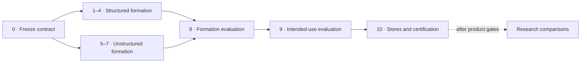

# Stage-by-stage implementation and release gates

[Documentation home](README.md) · [Architecture](architecture.md) · [Modelling rules](knowledge_graph_modelling.md) · [Testing](testing_guide.md)

This is the execution order for the repository. A later stage cannot compensate for a failed earlier stage: retrieval tuning cannot repair duplicate identities, and a graph database constraint cannot recover a relation whose source evidence was discarded.

`convert(...)` may return a draft graph after any stage so failures can be inspected. The hard gates below describe the **publishability/certification decision**, not whether a draft object can be returned.

Canonical ownership is `kg_construction.structured`, `kg_construction.unstructured`, and `kg_construction.evaluation`. Research comparison is isolated under `kg_construction.research`.

## Stage map



| Stages | Outcome | Failure means |
| --- | --- | --- |
| [0](#stage-0--freeze-the-execution-contract) | Immutable execution contract | No trustworthy run can start |
| [1](#stage-1--inventory-structured-sources)–[4](#stage-4--generate-and-validate-schema-projections) | Structured identity, relationships, and schema | Fix construction before evaluating |
| [5](#stage-5--preserve-immutable-unstructured-evidence)–[7](#stage-7--construct-semantic-assertions-without-losing-intent) | Evidence-grounded unstructured assertions | Quarantine or fix extraction |
| [8](#stage-8--evaluate-formation-quality)–[9](#stage-9--evaluate-the-declared-graph-usage) | Formation and declared-use observations | Draft remains inspectable but not publishable |
| [10](#stage-10--materialize-and-certify-stores) | Store execution and certification evidence | No release certificate |

## Stage 0 — freeze the execution contract

Inputs:

- `pyproject.toml`
- `models.manifest.yaml`
- `certification/services.yaml`
- `capability_manifest.yaml`
- `src/kg_construction/resources/publication_contracts_v1.yaml`
- `src/kg_construction/resources/service-runtime.env`

Actions:

1. Select the exact host profile.
2. Resolve Python distributions, service images, model revisions, model files, and the Ollama model content digest.
3. Hydrate those artifacts once.
4. Reject a requested accelerator profile when the host cannot execute it.
5. At the certification boundary, match the exact evaluation-suite bytes, raw and deterministic post-PII source snapshots, semantic configuration, model lock, governed schema, held-out gold, graph-builder contract, and policy digest to a reviewed release contract.
6. Enforce repository-owned metric floors and latency/resource ceilings before construction; a caller cannot weaken policy by editing and re-sealing a fixture.
7. Export one locked Neo4j/Memgraph/Ollama environment into setup, readiness, doctor, public workloads, and every certification subprocess; reject empty values and conflicting legacy aliases.

Artifacts:

- `uv.lock`
- `models.lock.yaml`
- `certification/services.lock.yaml`
- `certification/execution_plan.yaml`

Gate: every applicable capability has one executable semantic certifier. MLX is applicable and mandatory on `darwin-arm64`; it is outside the declared Linux capability set rather than reported as skipped. A custom or self-approved suite is explicitly research-only and cannot cross the release boundary.

## Stage 1 — inventory structured sources

Implementation:

- `kg_construction.structured.catalog`
- `kg_construction.structured.profiling`
- `kg_construction.structured.contracts`

Actions:

1. Load all related tables before mapping any one table.
2. Capture primary/candidate/composite keys, foreign keys, target keys, datatypes, nullability, controlled vocabularies, and table kind.
3. Treat declarations as authoritative and profiling as an evidence-bearing proposal.
4. Resolve one modelling plan and derive all schema projections from it.
5. Build a uniqueness-checked index for every declared primary or candidate key; a foreign key targets that exact index and resolves to the target entity's canonical primary identity.

Gate: every included column has a semantic role and materialization decision; declared keys have valid arity and scope, and every raw and post-normalization key is unique. A duplicate candidate key is an error, never an arbitrary “first row wins” choice.

## Stage 2 — resolve structured identity and categories

Implementation:

- `kg_construction.structured.mapping`
- `kg_construction.structured.identity`
- `kg_construction.structured.contracts`

Actions:

1. Serialize composite keys as canonical JSON arrays.
2. Keep identifier lexicals as strings unless an explicit datatype says otherwise, so identifiers such as `01` and `1` cannot silently merge.
3. Apply source/global/cross-source identity scope explicitly.
4. Keep missing keys source-local. Derive keyless identities from canonical row content and a deterministic duplicate-occurrence index, never input order.
5. Distinguish scalar enumerations, governed concepts, and business entities.
6. Key a governed concept by vocabulary scheme and canonical code after the column's declared Unicode/case/whitespace canonicalization rule.
7. Preserve the raw source value and quarantine unknown values in a closed vocabulary.

Hard gates:

- categorical duplication rate = `0`;
- composite-key collision count = `0`;
- raw and normalized declared-key collision count = `0`;
- row-permutation identity changes = `0`;
- false merges remain below the declared identity threshold.

## Stage 3 — form structured relationships

Implementation:

- `kg_construction.structured.catalog`
- `kg_construction.structured.mapping`
- `kg_construction.infrastructure.ontology.validation`

Actions:

1. Resolve each foreign key against the declared target table and key. Alternate and composite candidate keys resolve through their declared index to the target entity's primary canonical ID.
2. Emit no edge when the target is absent; retain the raw unresolved key.
3. Convert a pure two-key join table into a direct edge.
4. Convert qualified, temporal, attributed, or n-ary joins into association or event nodes.
5. Preserve relationship qualifiers in the deduplication identity.

Hard gates:

- dangling edge rate = `0`;
- fabricated target count = `0`;
- qualifier preservation = `1`;
- domain, range, datatype, and cardinality violations = `0`.

## Stage 4 — generate and validate schema projections

Implementation:

- `kg_construction.structured.contracts`
- `kg_construction.structured.schema_projection`
- `kg_construction.infrastructure.ontology`
- `kg_construction.infrastructure.graph_builders`

Actions:

1. Generate property-graph, JSON-LD, OWL 2 RL, SHACL, Neo4j constraint, and evaluation contracts from the same plan.
2. Assert agreement across all projections.
3. Build property, RDF, and evidence graphs from the same construction batch.
4. Emit `sh:in` for closed controlled vocabularies.
5. Execute SHACL and retain the complete validation report.

Gate: SHACL must have executed and `sh:conforms` must be true; an absent SHACL run is a failure, not a zero-violation result.

## Stage 5 — preserve immutable unstructured evidence

Implementation:

- `kg_construction.unstructured.Claim`
- `kg_construction.unstructured.pipeline`

Actions:

1. Create a versioned document identity from the immutable content.
2. Segment while retaining absolute, end-exclusive offsets.
3. Validate `text[start:end] == quote` for every segment and provider output.
4. Keep Document, Mention, ObservedEntity, CanonicalEntity, semantic assertion (`Claim` in the implementation), and Event as separate resource layers.

Hard gates:

- exact segment coverage = `1`;
- document-version mismatch count = `0`;
- promoted evidence coverage = `1`;
- promoted provenance coverage = `1`.

## Stage 6 — execute the mandatory model ensemble

Implementation:

- `kg_construction.infrastructure.extractors.model_backed.mentions`
- `kg_construction.infrastructure.extractors.model_backed.relations`
- `kg_construction.infrastructure.extractors.model_backed.claims`
- `kg_construction.infrastructure.extractors.model_backed.factory`

Every profile runs one composed bundle containing:

- GLiNER entity extraction;
- Transformers token-classification NER;
- spaCy NER;
- GLiNER RelEx;
- Qwen3 structured extraction through Transformers;
- Qwen3 structured extraction through Ollama;
- the locked sentence-transformer embedding resolver;
- the locked cross-encoder resolver; and
- the declared external reconciliation/linking providers.

Apple Silicon additionally runs Qwen3 through MLX. Providers load only the hydrated local artifact recorded in `models.lock.yaml`. All providers are attempted; any provider failure makes the stage fail with the aggregated error. The union retains provider-agreement evidence.

Gate: required provider IDs = executed provider IDs, with exact offsets and complete model revision/configuration provenance. The doctor recomputes every selected artifact size and SHA-256 from `models.lock.yaml`; importing a package or finding a directory is not sufficient.

## Stage 7 — construct semantic assertions without losing intent

Implementation:

- `kg_construction.unstructured.pipeline`
- `kg_construction.unstructured.Claim`

Actions:

1. Extract relations, facts, events, and intents into a reified semantic-assertion model (`Claim` in the implementation).
2. Preserve negation, modality, attribution, temporal/quantity qualifiers, and typed event roles.
3. Resolve document-local coreference conservatively.
4. Run the mandatory identity ensemble and retain NIL when no candidate reaches its governed threshold.
5. Create canonical identities only from an explicit resolver/linker.
6. Align predicates to the governed ontology supplied by the versioned release contract.
7. Validate the materialized RDF with the governed SHACL shapes.
8. Promote only exact, complete, in-schema claims; quarantine the rest.

Gate: unsupported promoted claim rate = `0`. Entity, span, relation, event-role, intent/fact, negation, modality, temporal, and attribution metrics must all report `executed=true` when required by the evaluation contract.

## Stage 8 — evaluate formation quality

Implementation:

- `kg_construction.evaluation`
- `tests/fixtures/gold_standards/`

The old `kg_construction.infrastructure.evaluation.*` paths are explicit compatibility shims only. Product metrics and gates are implemented in the canonical evaluation package; no wildcard façade is used.

Required metric families:

- identity and conciseness;
- referential and semantic integrity;
- completeness and source-field coverage;
- evidence and provenance;
- structural health;
- entity resolution;
- extraction/claim correctness;
- operational cost and latency.

Exact mention scoring uses `(document version, start, end, type)` and occurrence counts. Relation scoring aligns semantic endpoints, direction, and qualifiers; run-specific internal IDs are not compared as if they were gold identities. Empty gold/prediction mappings have zero support and cannot pass.

Each observation records purpose, value, support, threshold, comparator, execution state, fixture hash, output hash, and pass/fail. A required family with no fixture, no support, insufficient prediction/gold coverage, or no execution fails closed.

## Stage 9 — evaluate the declared graph usage

The frozen graph is evaluated separately for every declared consumer. Evaluation fixtures contain workload definitions and gold judgments, not caller-computed predictions. A runner executes each workload against the frozen graph/store snapshot and records the graph hash and fixture hash:

- SQL-like/property-graph query correctness and aggregation accuracy;
- NoSQL traversal/path correctness;
- GraphRAG retrieval, multi-hop answers, faithfulness, and citations;
- vector Recall@k, MRR, nDCG, filters, latency, memory, and index coverage;
- filtered link-prediction MRR/Hits@k with popularity strata;
- recommendation accuracy, coverage, novelty, and diversity;
- competency-question and inference accuracy.

Gate: formation gates remain conjunctive. A strong downstream score cannot override duplicate identities, unsupported claims, dangling edges, or SHACL violations. Validation, every required quality family, and every declared intended-use family must pass before certification can authorize publication. Draft API and CLI conversion still returns the graph and failed observations for diagnosis; it does not turn that draft into a release.

## Stage 10 — materialize and certify stores

Implementation:

- `kg_construction.infrastructure.graph_stores`
- `scripts/certify_capability.py`
- `kg_construction.certification`

Actions:

1. Export and ingest the same frozen graph into Neo4j, Memgraph, Ladybug, NetworkX, and RDF.
2. Execute semantic write/read queries, not import-only checks.
3. Execute every applicable capability in a fresh process with a run nonce.
4. Bind evidence to fixture and output SHA-256 values.
5. Execute one composed product scenario that proves all mandatory provider IDs participated, the same graph was written and read through the stores, and validation, formation, extraction, and intended-use gates passed together.

Final condition:

```text
declared = configured = instantiated = executed = evaluated = passed
skipped = 0
fallback = 0
```

Run the final condition with:

```bash
bash run_all_approaches.sh
```

## Research after the product gates

Simple benchmarks, weighted technique leaderboards, synthetic cross-source resolver comparisons, Graph ML experiments, and mocked provider demonstrations run only after and outside the product stages:

```bash
make research-smoke
```

They may explain trade-offs, but never change a product metric, provider requirement, or publication decision.

## Related guides

- [Architecture](architecture.md) explains package ownership and end-to-end data flow.
- [Getting started](getting_started.md) turns the stages into runnable setup and hard-pass commands.
- [Evaluation metrics](evaluation_metrics.md) defines the gates used in stages 8 and 9.
- [Testing](testing_guide.md) maps each stage to focused tests and reports.
