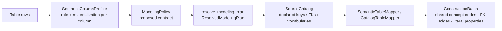
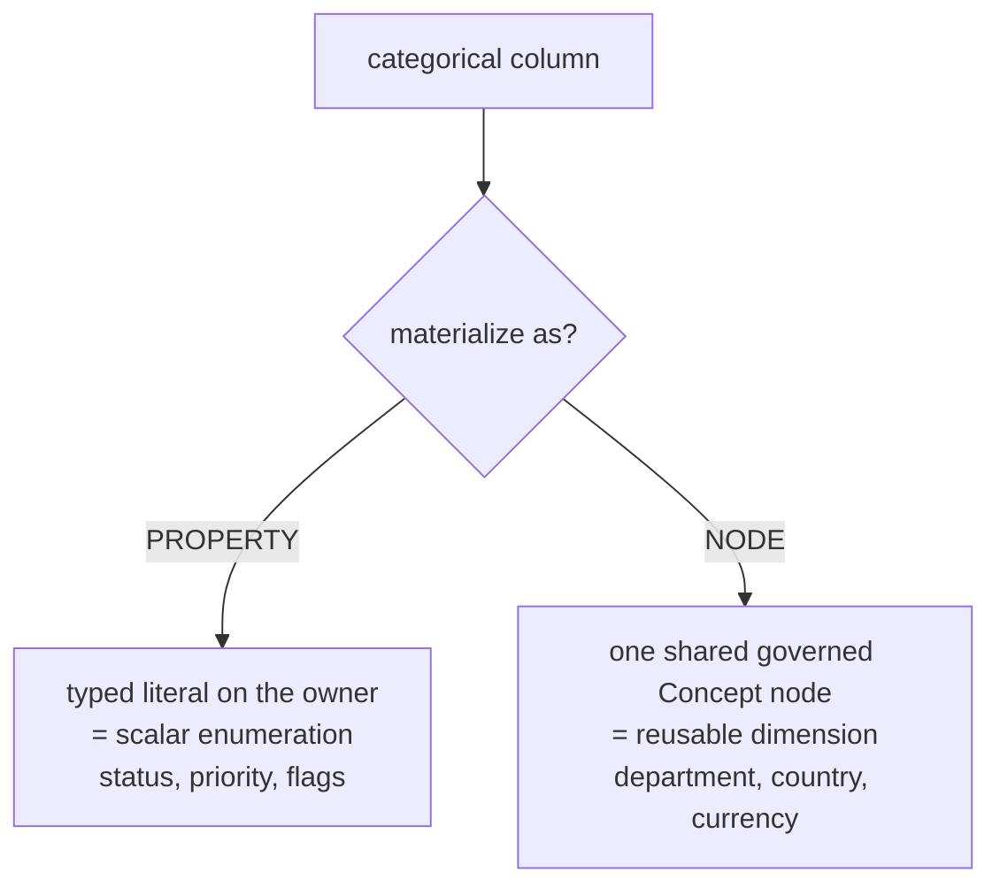
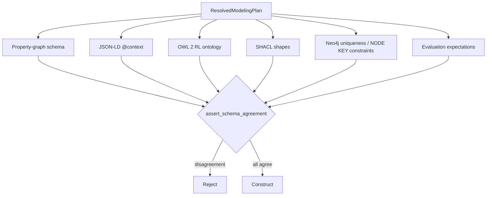
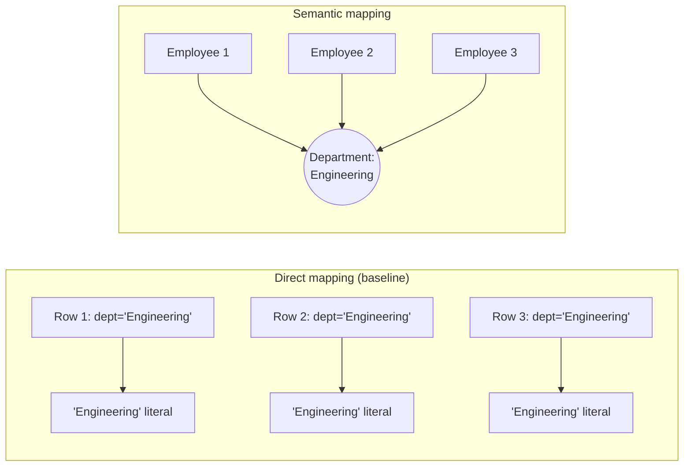
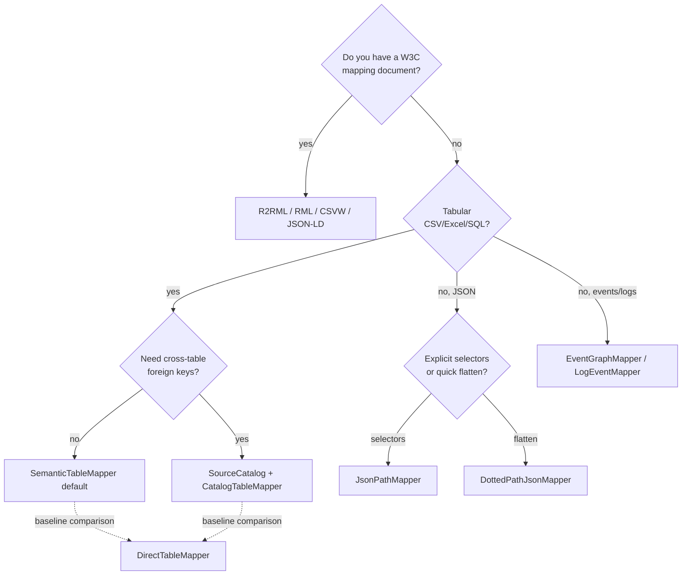

# Structured data → knowledge graph: techniques explained

This is the technical reference for **Pillar 1**: converting tables (CSV, Excel,
SQL) and semi-structured payloads (JSON, XML, JSON-LD) into a graph where each
real thing is identified once, categorical values are shared, and foreign keys
become typed edges.

The governing rule of this pillar: **cardinality is evidence, not semantics.** A
value that repeats 10,000 times is not automatically an entity. Two independent
decisions are made for every column — its *semantic role* and its *physical
materialization* — and only their combination decides node vs. edge vs.
property.

Contents:

1. [The default path: the semantic pipeline](#1-the-default-path-the-semantic-pipeline)
2. [Technique 1 — semantic column profiling](#2-technique-1--semantic-column-profiling)
3. [Technique 2 — the resolved modelling plan and six projections](#3-technique-2--the-resolved-modelling-plan-and-six-projections)
4. [Technique 3 — the source catalog and cross-table foreign keys](#4-technique-3--the-source-catalog-and-cross-table-foreign-keys)
5. [Technique 4 — semantic table materialization](#5-technique-4--semantic-table-materialization)
6. [Technique 5 — the direct table mapper (baseline)](#6-technique-5--the-direct-table-mapper-baseline)
7. [Technique 6 — standards-based mapping (R2RML / RML / CSVW / JSON-LD / OBDA)](#7-technique-6--standards-based-mapping-r2rml--rml--csvw--json-ld--obda)
8. [Technique 7 — semi-structured mapping (JSONPath / dotted-path / XPath)](#8-technique-7--semi-structured-mapping-jsonpath--dotted-path--xpath)
9. [Technique 8 — event / log mapping](#9-technique-8--event--log-mapping)
10. [Choosing a technique](#10-choosing-a-technique)

---

## 1. The default path: the semantic pipeline

When you call `construct_kg(..., source_type="csv")`, the config default
`pipeline.structured_mapping="semantic"` routes the table through a four-module
chain. `direct` selects the legacy baseline instead.



| Module | File | Produces |
| --- | --- | --- |
| `SemanticColumnProfiler` | `application/semantic_profiler.py` | `ColumnRoleAssignment` per column + a proposed `ModelingPolicy` |
| `resolve_modeling_plan` | `application/plan_resolution.py` | `ResolvedModelingPlan` (the only construction-ready contract) |
| `SourceCatalog` / `CatalogTableMapper` | `application/source_catalog.py` | Cross-table FK resolution, governed vocabularies, coverage |
| `SemanticTableMapper` | `application/semantic_table_mapper.py` | The materialized `ConstructionBatch` |

---

## 2. Technique 1 — semantic column profiling

**File:** `application/semantic_profiler.py` · **Registry:** `semantic_column_profiler`

### What it does technically

For each column it computes a `ColumnFeatures` vector — dtype, row count,
distinct count, `distinct_ratio`, `null_rate`, uniqueness, and average text
length — and detects foreign keys by *value containment* (do this column's
values live inside another table's key column?). It then assigns two independent
labels with a transparent, dependency-free rule set. Every decision carries a
confidence and a written rationale for review.

**Decision A — semantic role** (`domain/modeling.ColumnRole`):

| Role | Signal | Example |
| --- | --- | --- |
| `identifier` | name matches `id/uuid/pk/_id…`, high uniqueness | `emp_id` |
| `entity reference` | name matches `_id/_fk/_ref/_code…`, values contained in another key | `manager_id`, `department_id` |
| `categorical dimension` | low distinct ratio + bounded absolute distinct, categorical name | `department`, `status` |
| `measure` | numeric with an owner; measure-like name | `salary`, `amount` |
| `temporal` | date/timestamp name or value shape | `created_at` |
| `free text` | long average length, prose-like name | `description` |
| `metadata` / ignore | processing columns, or blocked names (`password`, `ssn`, `cvv`) | secrets are excluded |

**Decision B — materialization** (`identity | node | edge | property | excluded`).

The two are deliberately orthogonal. This is what fixes the classic
node-vs-property confusion:



### The promotion rule (why `status` stays a property but `department` becomes a node)

Low cardinality **never** promotes a column on its own. `PromotionThresholds`
(`application/modeling_policy.py`) encodes the guardrails:

| Threshold | Default | Effect |
| --- | ---: | --- |
| `categorical_max_distinct_ratio` | 0.5 | above this, values are too unique to be a category |
| `categorical_max_distinct_absolute` | 1000 | hard cap on category count |
| `min_rows_for_ratio` | 20 | small tables don't trust ratios |
| `keep_as_property_max_distinct` | 2 | booleans/binaries stay properties |
| `free_text_min_avg_length` | 40 | long strings are text, not categories |
| `supernode_fanin_warning` | 10000 | a dimension every row points to gets a supernode guard |
| `supernode_policy` | `warn` | `warn` / `keep_property` / `allow` |

Only names matching `_REUSABLE_DIMENSION_NAME_RE` (department, team, country,
region, currency, brand, supplier, product, location, warehouse…) are eligible
for *inferred* node promotion. A scalar enum (`status`, `priority`, `severity`,
`type`, `stage`) stays a property unless a source declaration explicitly
promotes it to a governed concept. This mirrors ydata/pandas-profiling's
low-cardinality heuristics but refuses to let cardinality alone decide meaning.

Profiling also proposes **key candidates** (`KeyCandidate` with confidence and
evidence) and detects **composite keys** — it never silently adopts the first
unique column as the primary key.

---

## 3. Technique 2 — the resolved modelling plan and six projections

**Files:** `application/resolved_plan.py`, `application/plan_resolution.py`,
`application/schema_projections.py`

### What it does technically

The `ModelingPolicy` the profiler proposes is a *proposal*. `resolve_modeling_plan`
lowers it into a `ResolvedModelingPlan` — the single construction-ready contract
that carries every resolved facet: keys, identity scope, entity-vs-concept +
`concept_scheme`, datatypes/nullability, cardinality, canonicalization rules,
foreign-key `on_missing=SKIP` policy, provenance, confidence, and review state.
RDF is pinned to `rdf-1.1`, SHACL `1.0`, OWL `owl2-rl`.

### The six-projection agreement gate

The single resolved plan is projected into six artifacts, and
`assert_schema_agreement()` parses them back and proves they all describe the
same graph. This prevents the common failure where mapper code, docs, DB
constraints, and evaluation fixtures each describe a *different* graph.



Agreement is checked on classes, keys, predicates, datatypes, domain/range, and
cardinality. OWL/SHACL turtle is parsed with rdflib; Neo4j Cypher is parsed by
regex; the extracted facets must equal the plan.

### Identity design

Identity is resolved *before* edges are formed:

- Declared business keys beat row numbers.
- Composite keys are serialized as **canonical JSON arrays**, not delimiter
  strings, so `["US","A|1"]` cannot collide with `["US|A","1"]`.
- **Identity scope**: `source` keeps equal keys from different files distinct;
  `global` is allowed only for a governed key; `cross_source` requires an
  explicit resolver and retains confidence/evidence.
- Missing/redacted keys get source-row identities — names are never promoted to
  global identifiers.

---

## 4. Technique 3 — the source catalog and cross-table foreign keys

**File:** `application/source_catalog.py` · **Registry:** `source_catalog`, `semantic_table_mapper` (as `CatalogTableMapper`)

### What it does technically

`SourceCatalog` accepts *declared* structure and resolves all tables together
before mapping, so a foreign key can point at a row in another file.
Declarations are authoritative; profiling is only a fallback and its confidence
is retained.

```python
catalog = SourceCatalog().declare(
    TableDeclaration(
        table_name="employees.csv", record_type="Employee",
        primary_key=["emp_id"],
        foreign_keys=[DeclaredForeignKey(columns=["manager_id"], target_table="employees")],
    )
)
```

Declared structure can come from four sources, with a profiler fallback:

| Declaration source | Standard alignment |
| --- | --- |
| database metadata (PK/FK constraints) | W3C RDB Direct Mapping |
| CSVW `tableSchema` foreign keys | CSV on the Web |
| R2RML referencing object maps | R2RML |
| explicit user policy (`TableDeclaration`) | — |

### The critical invariant: never fabricate a target

A foreign key whose target row is **absent** is retained as a raw value — the
mapper emits **no placeholder node**. `DeclaredForeignKey` resolution reports
`target_available`; the plan's `on_missing=SKIP` keeps the value without
inventing identity. The catalog also reports
`declared_key_mapping_coverage` (what fraction of declared keys/FKs actually
mapped) so you can see cross-table completeness.

---

## 5. Technique 4 — semantic table materialization

**File:** `application/semantic_table_mapper.py` · **Registry:** `semantic_table_mapper`

### What it does technically

Consuming a `ResolvedModelingPlan`, the mapper walks every row and emits the
right graph object per column materialization. Its three signature behaviours:

**1. Shared concept nodes (no literal duplication).** A categorical materialized
as a node produces **one** shared concept candidate keyed by
`(concept_scheme, canonical_code)`, and every owning row emits an edge to it.
`"Engineering"` becomes a single `Department` node, not 8,000 repeated literals.



**2. Business identity separate from source-row identity.** The same business
key across two files resolves by identity scope; a keyless row gets a distinct
source-row identity instead of colliding.

**3. Canonicalization.** Surface values are normalized (Unicode NFKC, trim,
collapse whitespace, optional casefold, alias table) via `CanonicalizationRule`
while the `raw_value` is retained. Two spellings of the same value collapse into
one node; a closed vocabulary rejects/quarantines an unknown code.

### Relationship formation

| Source shape | Graph result |
| --- | --- |
| resolved foreign key | typed edge to the actual target-table entity |
| missing FK target | raw value retained, **no** fabricated placeholder |
| pure 2-key join table | one direct relationship (no redundant row node) |
| join table with attributes / time / provenance / >2 roles | reified association/event node |
| repeated observations with different qualifiers | kept distinct (not deduplicated) |

Relationship direction, domain, range, cardinality, source/target columns, and
missing-target policy are all part of the plan — there is no generic
`RELATED_TO` in a promoted schema.

### Exit gates (verified by gold fixtures)

- categorical duplication rate = **0**
- dangling-edge rate = **0**
- declared key/FK mapping coverage = **100%**
- re-ingestion produces **zero semantic delta** (idempotent)

The employee gold fixture builds 8 employees, 3 departments, 8 department edges,
and 7 manager edges with no duplicated literals.

---

## 6. Technique 5 — the direct table mapper (baseline)

**File:** `infrastructure/mapping/direct_table_mapper.py` · **Registry:** `direct_table_mapper` (+ the `table_to_node_mapping`, `row_to_entity_mapping`, `primary_key_to_id_mapping`, `foreign_key_to_edge_mapping`, `column_to_property_mapping`, `schema_profiling`, `column_type_inference` aliases)

### What it does technically

The classic relational-direct-mapping baseline: one node per row, primary key →
node id, every non-key column → a literal property, and explicitly configured
foreign keys → edges (`ForeignKeyMappingConfig`). It is fast and fully
deterministic, but it produces **duplicated categorical literals** and only
forms edges you configure by hand.

It is retained as a **named baseline** for comparison (select with
`pipeline.structured_mapping="direct"`), and the registry aliases document the
sub-steps of relational mapping (row→entity, PK→id, FK→edge, column→property,
type inference). Use it to demonstrate *why* the semantic path is the default —
the benchmark leaderboard ranks `semantic_table_mapper` first for CSV precisely
because the direct mapper repeats literals.

---

## 7. Technique 6 — standards-based mapping (R2RML / RML / CSVW / JSON-LD / OBDA)

**File:** `infrastructure/mapping/standards.py` · **Registry:** `r2rml_mapper`, `rml_mapper`, `csvw_mapper`, `jsonld_mapper`, `obda_virtual_graph_mapper`

When you already have a W3C mapping document, these executable mappers apply it
directly rather than re-inferring semantics.

| Mapper | Standard | Input | Technique summary |
| --- | --- | --- | --- |
| `R2RMLMapper` | [R2RML](https://www.w3.org/TR/r2rml/) | SQL/relational | Executes triples maps: subject map + predicate-object maps + referencing object maps (join conditions) → RDF triples |
| `RMLMapper` | [RML](https://rml.io/) | CSV/JSON/XML | Generalises R2RML to non-relational logical sources with the same term-map model |
| `CSVWMapper` | [CSV on the Web](https://www.w3.org/TR/csv2rdf/) | CSV + JSON metadata | Applies `tableSchema` (columns, datatypes, virtual columns, foreign keys) and validates; emits `CSVWValidationReport` |
| `JSONLDMapper` | [JSON-LD](https://www.w3.org/TR/json-ld11/) | JSON-LD | Uses the `@context` to lift keys into IRIs directly |
| `OBDAVirtualGraphMapper` | OBDA | SQL | Virtual knowledge graph: maps queries onto the source without materialising, for federated/virtual access |

Term maps (`TermMapConfig`) support the R2RML/RML subset — constant, column,
and template terms — and joins (`JoinConditionConfig`) implement referencing
object maps. Because these consume declared mappings, they are the most precise
option when a mapping already exists; the semantic profiler is the answer when
one does *not*.

---

## 8. Technique 7 — semi-structured mapping (JSONPath / dotted-path / XPath)

**File:** `infrastructure/mapping/semi_structured.py` · **Registry:** `jsonpath_mapper`, `dotted_path_json_mapper`, `xmlpath_mapper`, `api_response_mapper`

| Mapper | Technique |
| --- | --- |
| `JsonPathMapper` | Uses `jsonpath_ng` selectors: a `root_path` locates entity objects, `JsonPropertyMapping` selectors pull properties, and `JsonArrayEdgeMapping` turns object-array matches into child entities + edges. Each value carries **path evidence** (the JSONPath that produced it). |
| `DottedPathJsonMapper` | Lightweight fallback: flattens nested JSON into dotted-key properties (`owner.team`, `deps[0].name`) on one node. |
| `XMLPathMapper` | XPath-selector equivalent for XML documents. |
| `APIResponseMapper` | Maps a structured API response envelope to entities/edges. |

The JSONPath mapper is the recommended semi-structured technique because its
selectors are explicit and its evidence is exact; the dotted-path mapper is for
quick, low-ceremony flattening.

---

## 9. Technique 8 — event / log mapping

**File:** `infrastructure/mapping/` · **Registry:** `event_graph_mapper`, `log_event_mapper`, `html_metadata_mapper`

| Mapper | Technique |
| --- | --- |
| `EventGraphMapper` | Turns event payloads/logs into event nodes with typed roles (actor, object, time) — the reified n-ary form rather than a flat triple |
| `LogEventMapper` | Parses log lines into structured event records |
| `HTMLMetadataMapper` | Lifts HTML/webpage metadata (microdata, meta tags) into candidates |

These implement the modelling rule that a time-stamped, multi-participant
occurrence is an **event resource**, not a single edge.

---

## 10. Choosing a technique



| Priority | Technique | When |
| --- | --- | --- |
| **Default** | `semantic_table_mapper` | Any single table; correct identity + shared dimensions out of the box |
| **Multi-table** | `source_catalog` + `CatalogTableMapper` | Foreign keys that cross files/tables |
| **Have a mapping** | `r2rml`/`rml`/`csvw`/`jsonld` | A declared standards mapping already exists |
| **JSON** | `jsonpath_mapper` | Nested JSON with known structure |
| **Events** | `event_graph_mapper` | Time-stamped, multi-role occurrences |
| **Baseline only** | `direct_table_mapper` | Comparison / demonstrating literal duplication |

See the runnable commands for each in the
[README run guide](../README.md#running-every-technique) and how to test them in
the [testing guide](testing_guide.md).
