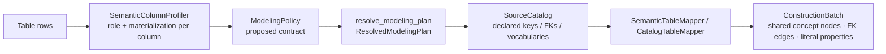
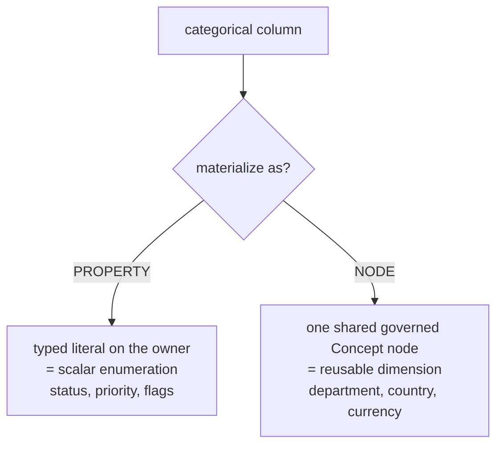
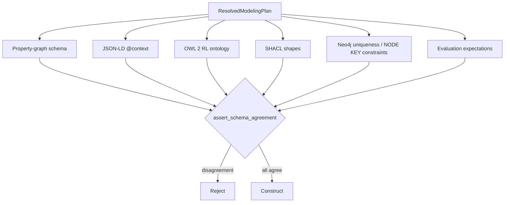
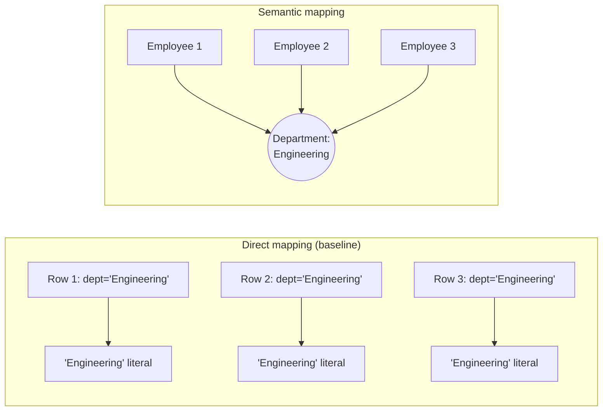
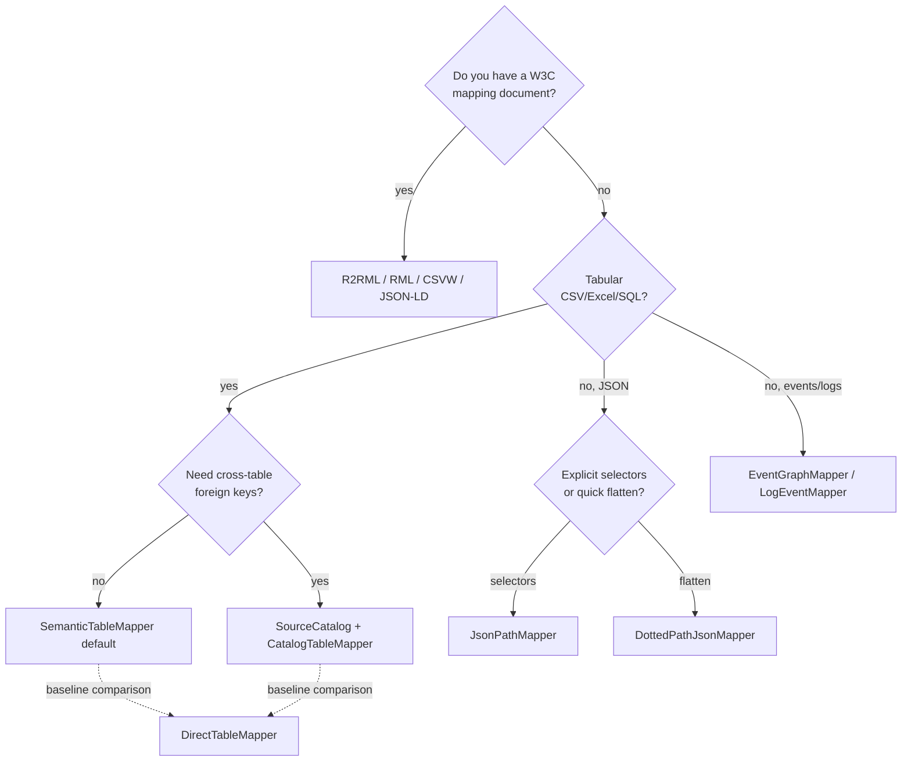

# Structured data → knowledge graph: techniques explained

[Documentation home](README.md) / Structured construction techniques

This guide explains **Pillar 1**: converting tables (CSV, Excel, SQL) and semi-structured payloads (JSON, XML, JSON-LD) into a correctly identified and related graph. Read the [repository architecture](architecture.md) for package boundaries or the [formation contract](knowledge_graph_modelling.md#pillar-1-structured-data-to-knowledge-graph) for normative stage gates.

- **Each real thing is identified once.**
- **Reusable governed categories become shared concept nodes; scalar enumerations remain properties.**
- **Foreign keys become typed edges.**

The governing rules of this pillar are:

- **Cardinality is evidence, not semantics** — a value that repeats 10,000 times is not automatically an entity.
- **Two independent decisions per column** — its *semantic role* and its *physical materialization*.
- **Only their combination decides** node vs. edge vs. property.

> **Running a technique:** `convert(data, source_format, technique)` returns a draft graph plus every computed metric. Draft return is deliberately total; it is not a publication certificate. Certified construction applies all mandatory gates through the zero-skip hard pass.

Canonical product namespace: `kg_construction.structured`.

## Guide map

| Question | Start here |
| --- | --- |
| What happens by default? | [The semantic pipeline](#1-the-default-path-the-semantic-pipeline) |
| How does a column become an identity, node, edge, or property? | [Semantic column profiling](#2-technique-1--semantic-column-profiling) |
| How are identity and schema kept consistent? | [Resolved modelling plan](#3-technique-2--the-resolved-modelling-plan-and-six-projections) |
| How do foreign keys work across tables or files? | [Source catalog](#4-technique-3--the-source-catalog-and-cross-table-foreign-keys) |
| Which mapper should I select? | [Technique decision guide](#10-choosing-a-technique) |

Detailed contents:

1. [The default path: the semantic pipeline](#1-the-default-path-the-semantic-pipeline)
2. [Technique 1 — semantic column profiling](#2-technique-1--semantic-column-profiling)
3. [Technique 2 — the resolved modelling plan and six projections](#3-technique-2--the-resolved-modelling-plan-and-six-projections)
4. [Technique 3 — the source catalog and cross-table foreign keys](#4-technique-3--the-source-catalog-and-cross-table-foreign-keys)
5. [Technique 4 — semantic table materialization](#5-technique-4--semantic-table-materialization)
6. [Technique 5 — the direct table mapper (baseline)](#6-technique-5--the-direct-table-mapper-baseline)
7. [Technique 6 — standards-based mapping (R2RML / RML / CSVW / JSON-LD / OBDA)](#7-technique-6--standards-based-mapping-r2rml--rml--csvw--json-ld--obda)
8. [Technique 7 — semi-structured mapping (JSONPath / dotted-path / XPath)](#8-technique-7--semi-structured-mapping-jsonpath--dotted-path--xpath)
9. [Technique 8 — event / log mapping](#9-technique-8--event--log-mapping)
10. [Choosing a technique](#10-choosing-a-technique)

---

## 1. The default path: the semantic pipeline

- **Default is semantic** — `convert(..., "csv")` uses the governed semantic mapper unless a different draft technique is named explicitly.
- **Four-module chain** — profiler → resolved plan → source catalog → mapper.
- **`direct` is a baseline** — it is retained for explicit comparison and standards-level direct mapping, not as the semantic product default.



| Module | Canonical package | Produces |
| --- | --- | --- |
| `SemanticColumnProfiler` | `kg_construction.structured.profiling` | `ColumnRoleAssignment` per column + a proposed `ModelingPolicy` |
| `resolve_modeling_plan` | `kg_construction.structured.planning` | `ResolvedModelingPlan` (the only construction-ready contract) |
| `SourceCatalog` / `CatalogTableMapper` | `kg_construction.structured.catalog` | Cross-table FK resolution, governed vocabularies, coverage |
| `SemanticTableMapper` | `kg_construction.structured.mapping` | The materialized `ConstructionBatch` |

---

## 2. Technique 1 — semantic column profiling

**Public module:** `kg_construction.structured.profiling` · **Registry:** `semantic_column_profiler`

### What it does technically

- **Computes a `ColumnFeatures` vector** — dtype, row count, distinct count, `distinct_ratio`, `null_rate`, uniqueness, and average text length.
- **Detects foreign keys by value containment** — do this column's values live inside another table's key column?
- **Assigns two independent labels** with a transparent, dependency-free rule set.
- **Every decision is auditable** — it carries a confidence and a written rationale for review.

**Decision A — semantic role** (`domain/modeling.ColumnRole`):

| Role | Signal | Example |
| --- | --- | --- |
| `identifier` | name matches `id/uuid/pk/_id…`, high uniqueness | `emp_id` |
| `entity reference` | name matches `_id/_fk/_ref/_code…`, values contained in another key | `manager_id`, `department_id` |
| `categorical dimension` | low distinct ratio + bounded absolute distinct, categorical name | `department`, `status` |
| `measure` | numeric with an owner; measure-like name | `salary`, `amount` |
| `temporal` | date/timestamp name or value shape | `created_at` |
| `free text` | long average length, prose-like name | `description` |
| `metadata` / ignore | processing columns, or blocked names (`password`, `ssn`, `cvv`) | secrets are excluded |

**Decision B — materialization** (`identity | node | edge | property | excluded`).

The two are deliberately orthogonal. This is what fixes the classic node-vs-property confusion:



### The promotion rule (why `status` stays a property but `department` becomes a node)

Low cardinality **never** promotes a column on its own. `kg_construction.structured.PromotionThresholds` encodes the guardrails:

| Threshold | Default | Effect |
| --- | ---: | --- |
| `categorical_max_distinct_ratio` | 0.5 | above this, values are too unique to be a category |
| `categorical_max_distinct_absolute` | 1000 | hard cap on category count |
| `min_rows_for_ratio` | 20 | small tables don't trust ratios |
| `keep_as_property_max_distinct` | 2 | booleans/binaries stay properties |
| `free_text_min_avg_length` | 40 | long strings are text, not categories |
| `supernode_fanin_warning` | 10000 | a dimension every row points to gets a supernode guard |
| `supernode_policy` | `warn` | `warn` / `keep_property` / `allow` |

- **Only reusable dimensions are promotable** — names matching `_REUSABLE_DIMENSION_NAME_RE` (department, team, country, region, currency, brand, supplier, product, location, warehouse…) qualify for *inferred* node promotion.
- **Scalar enums stay properties** — `status`, `priority`, `severity`, `type`, `stage` remain literals unless a source declaration promotes them to a governed concept.
- **Cardinality never decides meaning** — this mirrors ydata/pandas-profiling heuristics but refuses to promote on count alone.
- **Keys are proposed, not assumed** — `KeyCandidate` carries confidence + evidence, composite keys are detected, and the first unique column is never silently adopted as the primary key.

---

## 3. Technique 2 — the resolved modelling plan and six projections

**Public modules:** `kg_construction.structured.contracts`, `kg_construction.structured.planning`, and `kg_construction.structured.schema_projection`

### What it does technically

- **The policy is only a proposal** — `resolve_modeling_plan` lowers it into a `ResolvedModelingPlan`, the single construction-ready contract.
- **It carries every resolved facet** — keys, identity scope, entity-vs-concept + `concept_scheme`, datatypes/nullability, cardinality, canonicalization rules, missing-FK policy, provenance, confidence, and review state. A missing-FK `SKIP` means “emit no fabricated edge”; it is unrelated to certification skips.
- **Standards are pinned** — RDF `rdf-1.1`, SHACL `1.0`, OWL `owl2-rl`.

### The six-projection agreement gate

- **One plan → six artifacts** — each projection is derived from the same `ResolvedModelingPlan`.
- **Agreement is proven, not assumed** — `assert_schema_agreement()` parses the artifacts back and checks they describe the same graph.
- **It closes a classic failure** — mapper code, docs, DB constraints, and evaluation fixtures can no longer describe *different* graphs.



- **What is compared** — classes, keys, predicates, datatypes, domain/range, and cardinality.
- **How** — OWL/SHACL turtle is parsed with rdflib, Neo4j Cypher by regex.
- **The bar** — every extracted facet must equal the plan.

### Identity design

Identity is resolved *before* edges are formed:

- Declared business keys beat row numbers.
- Composite keys are serialized as **canonical JSON arrays**, not delimiter strings, so `["US","A|1"]` cannot collide with `["US|A","1"]`.
- **Identity scope**: `source` keeps equal keys from different files distinct; `global` is allowed only for a governed key; `cross_source` requires an explicit resolver and retains confidence/evidence.
- Missing/redacted keys get source-row identities — names are never promoted to global identifiers.

---

## 4. Technique 3 — the source catalog and cross-table foreign keys

**Public module:** `kg_construction.structured.catalog` · **Registry:** `source_catalog`, `semantic_table_mapper` (as `CatalogTableMapper`)

### What it does technically

- **Resolves all tables together** — `SourceCatalog` accepts *declared* structure before mapping, so a foreign key can point at a row in another file.
- **Declarations are authoritative** — profiling supplies an evidence-bearing proposal where a declaration is absent.
- **Proposal confidence is retained** — a profiled key/FK never masquerades as a declared one.

```python
catalog = SourceCatalog().declare(
    TableDeclaration(
        table_name="employees.csv", record_type="Employee",
        primary_key=["emp_id"],
        foreign_keys=[DeclaredForeignKey(columns=["manager_id"], target_table="employees")],
    )
)
```

Declared structure can come from four sources; profiling can propose unresolved facets:

| Declaration source | Standard alignment |
| --- | --- |
| database metadata (PK/FK constraints) | W3C RDB Direct Mapping |
| CSVW `tableSchema` foreign keys | CSV on the Web |
| R2RML referencing object maps | R2RML |
| explicit user policy (`TableDeclaration`) | — |

### The critical invariant: never fabricate a target

- **A missing target is never fabricated** — an absent FK row is kept as a raw value; the mapper emits **no placeholder node**.
- **Availability is reported** — `DeclaredForeignKey` resolution sets `target_available`; `on_missing=SKIP` keeps the value without inventing identity.
- **Completeness is measured** — `declared_key_mapping_coverage` reports the fraction of declared keys/FKs that actually mapped.

---

## 5. Technique 4 — semantic table materialization

**Public module:** `kg_construction.structured.mapping` · **Registry:** `semantic_table_mapper`

### What it does technically

Consuming a `ResolvedModelingPlan`, the mapper walks every row and emits the right graph object per column materialization. Three signature behaviours:

**1. Shared concept nodes (no literal duplication).**

- **One node per distinct value** — a categorical materialized as a node produces **one** shared concept candidate keyed by `(concept_scheme, canonical_code)`.
- **Every owner links to it** — each owning row emits an edge to that node.
- **Result** — `"Engineering"` becomes a single `Department` node, not 8,000 repeated literals.



**2. Business identity separate from source-row identity.**

- **Same key, two files** — resolves by identity scope.
- **Keyless row** — gets a distinct source-row identity instead of colliding.

**3. Canonicalization.**

- **Surfaces are normalized** — Unicode NFKC, trim, collapse whitespace, policy-controlled case folding, and an alias table (`CanonicalizationRule`), while `raw_value` is retained.
- **Spellings collapse** — two forms of the same value become one node.
- **Closed vocabularies are enforced** — an unknown code is rejected or quarantined.

### Relationship formation

| Source shape | Graph result |
| --- | --- |
| resolved foreign key | typed edge to the actual target-table entity |
| missing FK target | raw value retained, **no** fabricated placeholder |
| pure 2-key join table | one direct relationship (no redundant row node) |
| join table with attributes / time / provenance / >2 roles | reified association/event node |
| repeated observations with different qualifiers | kept distinct (not deduplicated) |

- **Fully specified in the plan** — direction, domain, range, cardinality, source/target columns, and missing-target policy.
- **No generic `RELATED_TO`** in a promoted schema.

### Exit gates (verified by gold fixtures)

- categorical duplication rate = **0**
- dangling-edge rate = **0**
- declared key/FK mapping coverage = **100%**
- re-ingestion produces **zero semantic delta** (idempotent)

The employee gold fixture builds, with no duplicated literals:

| Output | Count |
| --- | ---: |
| Employee nodes | 8 |
| Department nodes | 3 |
| Department edges | 8 |
| Manager edges | 7 |

---

## 6. Technique 5 — the direct table mapper (baseline)

**Runtime implementation:** `kg_construction.infrastructure.mapping.direct_table_mapper` · **Registry:** `direct_table_mapper` (plus the `table_to_node_mapping`, `row_to_entity_mapping`, `primary_key_to_id_mapping`, `foreign_key_to_edge_mapping`, `column_to_property_mapping`, `schema_profiling`, and `column_type_inference` aliases)

### What it does technically

The classic relational-direct-mapping baseline:

- **One node per row**; primary key → node id.
- **Every non-key column → a literal property.**
- **Foreign keys → edges** only when explicitly configured (`ForeignKeyMappingConfig`).
- **Fast and deterministic**, but it produces **duplicated categorical literals** and only forms the edges you wire by hand.

Why it is kept:

- **A named baseline** — select with `pipeline.structured_mapping="direct"`.
- **Documents the sub-steps** — registry aliases cover row→entity, PK→id, FK→edge, column→property, and type inference.
- **Characterizes the baseline defect** — formation metrics expose duplicated categorical literals even when a research ranking happens to reward other dimensions.

---

## 7. Technique 6 — standards-based mapping (R2RML / RML / CSVW / JSON-LD / OBDA)

**Runtime implementation:** `kg_construction.infrastructure.mapping.standards` · **Registry:** `r2rml_mapper`, `rml_mapper`, `csvw_mapper`, `jsonld_mapper`, `obda_virtual_graph_mapper`

When you already have a W3C mapping document, these executable mappers apply it directly rather than re-inferring semantics.

| Mapper | Standard | Input | Technique summary |
| --- | --- | --- | --- |
| `R2RMLMapper` | [R2RML](https://www.w3.org/TR/r2rml/) | SQL/relational | Executes triples maps: subject map + predicate-object maps + referencing object maps (join conditions) → RDF triples |
| `RMLMapper` | [RML](https://rml.io/) | CSV/JSON/XML | Generalises R2RML to non-relational logical sources with the same term-map model |
| `CSVWMapper` | [CSV on the Web](https://www.w3.org/TR/csv2rdf/) | CSV + JSON metadata | Applies `tableSchema` (columns, datatypes, virtual columns, foreign keys) and validates; emits `CSVWValidationReport` |
| `JSONLDMapper` | [JSON-LD](https://www.w3.org/TR/json-ld11/) | JSON-LD | Uses the `@context` to lift keys into IRIs directly |
| `OBDAVirtualGraphMapper` | OBDA | SQL | Virtual knowledge graph: maps queries onto the source without materialising, for federated/virtual access |

- **Term maps** — `TermMapConfig` supports the R2RML/RML subset (constant, column, template terms).
- **Joins** — `JoinConditionConfig` implements referencing object maps.
- **When to use** — most precise option when a mapping already exists; the semantic profiler is the answer when one does *not*.

---

## 8. Technique 7 — semi-structured mapping (JSONPath / dotted-path / XPath)

**Runtime implementation:** `kg_construction.infrastructure.mapping.semi_structured` · **Registry:** `jsonpath_mapper`, `dotted_path_json_mapper`, `xmlpath_mapper`, `api_response_mapper`

| Mapper | Technique |
| --- | --- |
| `JsonPathMapper` | Uses `jsonpath_ng` selectors: a `root_path` locates entity objects, `JsonPropertyMapping` selectors pull properties, and `JsonArrayEdgeMapping` turns object-array matches into child entities + edges. Each value carries **path evidence** (the JSONPath that produced it). |
| `DottedPathJsonMapper` | Minimal flattening mapper: writes nested JSON as dotted-key properties (`owner.team`, `deps[0].name`) on one node. |
| `XMLPathMapper` | XPath-selector equivalent for XML documents. |
| `APIResponseMapper` | Maps a structured API response envelope to entities/edges. |

- **JSONPath mapper is recommended** — explicit selectors, exact evidence.
- **Dotted-path mapper** — for quick, low-ceremony flattening.

---

## 9. Technique 8 — event / log mapping

**Runtime package:** `kg_construction.infrastructure.mapping` · **Registry:** `event_graph_mapper`, `log_event_mapper`, `html_metadata_mapper`

| Mapper | Technique |
| --- | --- |
| `EventGraphMapper` | Turns event payloads/logs into event nodes with typed roles (actor, object, time) — the reified n-ary form rather than a flat triple |
| `LogEventMapper` | Parses log lines into structured event records |
| `HTMLMetadataMapper` | Lifts HTML/webpage metadata (microdata, meta tags) into candidates |

- **The rule they implement** — a time-stamped, multi-participant occurrence is an **event resource**, not a single edge.

---

## 10. Choosing a technique



| Priority | Technique | When |
| --- | --- | --- |
| **Default** | `semantic_table_mapper` | Any single table; correct identity + shared dimensions out of the box |
| **Multi-table** | `source_catalog` + `CatalogTableMapper` | Foreign keys that cross files/tables |
| **Have a mapping** | `r2rml`/`rml`/`csvw`/`jsonld` | A declared standards mapping already exists |
| **JSON** | `jsonpath_mapper` | Nested JSON with known structure |
| **Events** | `event_graph_mapper` | Time-stamped, multi-role occurrences |
| **Baseline only** | `direct_table_mapper` | Comparison / demonstrating literal duplication |

## Next steps

| Goal | Continue with |
| --- | --- |
| Run a first structured conversion | [Getting started](getting_started.md) |
| Configure declarations, identity, vocabularies, and stores | [Configuration](configuration.md) |
| Understand structured formation and intended-use metrics | [Evaluation metrics](evaluation_metrics.md) |
| Trace the implementation stage by stage | [Stage-by-stage implementation](stage_by_stage_implementation.md) |
| Verify the behaviour with focused and full test suites | [Testing guide](testing_guide.md) |

The runnable product commands are also summarized in the [project README](../README.md). Technique comparison belongs to `kg_construction.research` and cannot establish publishability.
