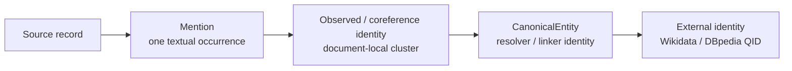
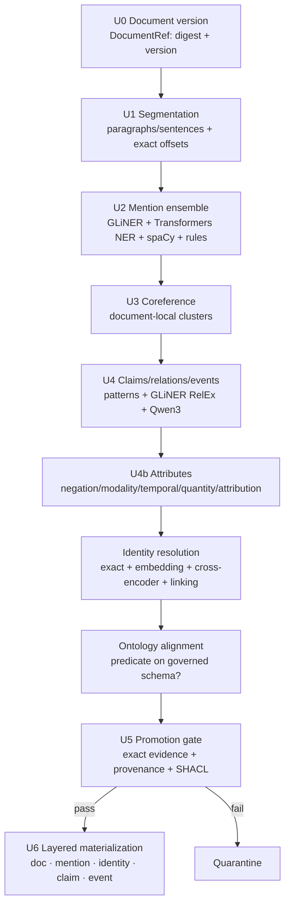
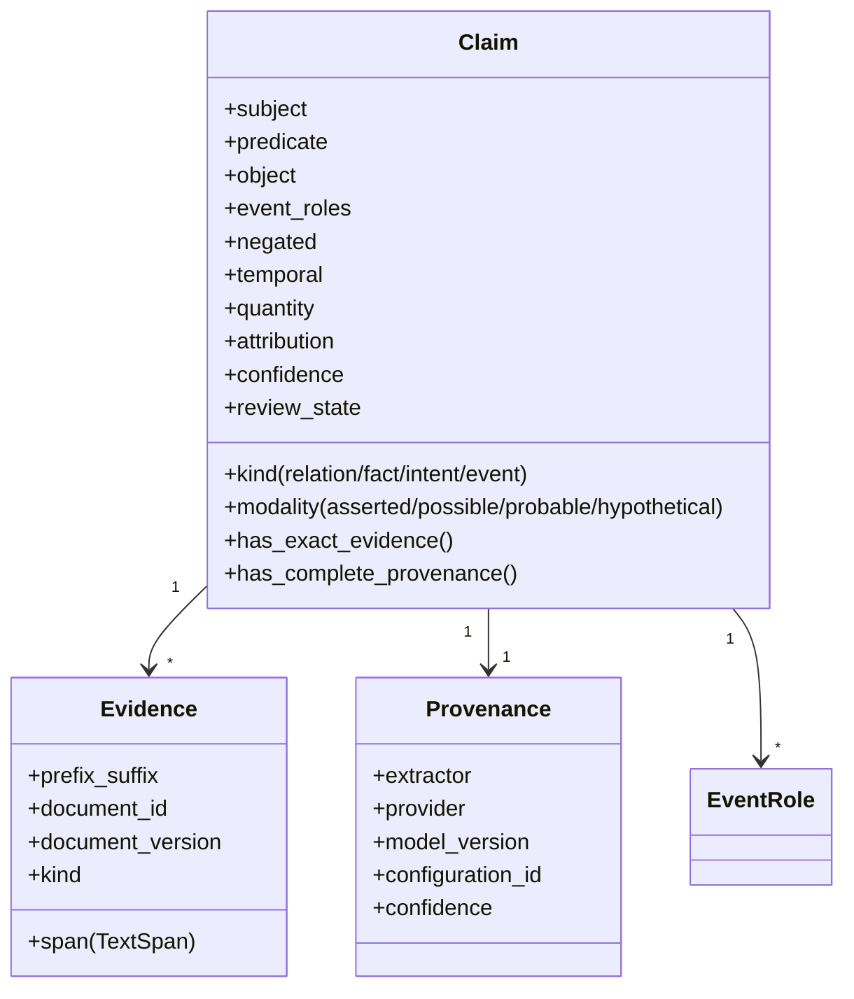
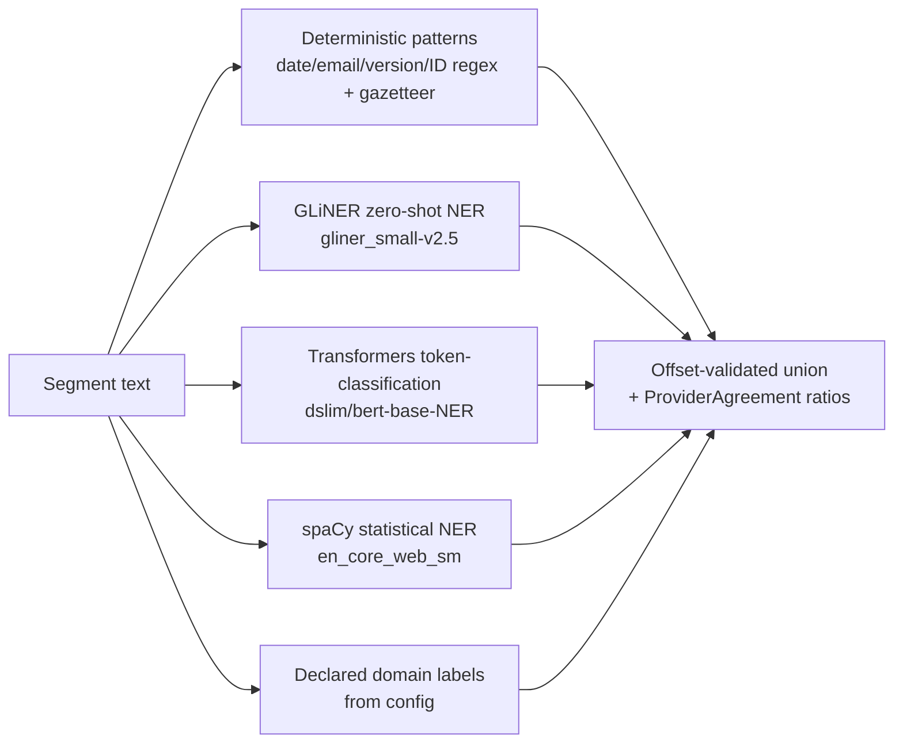
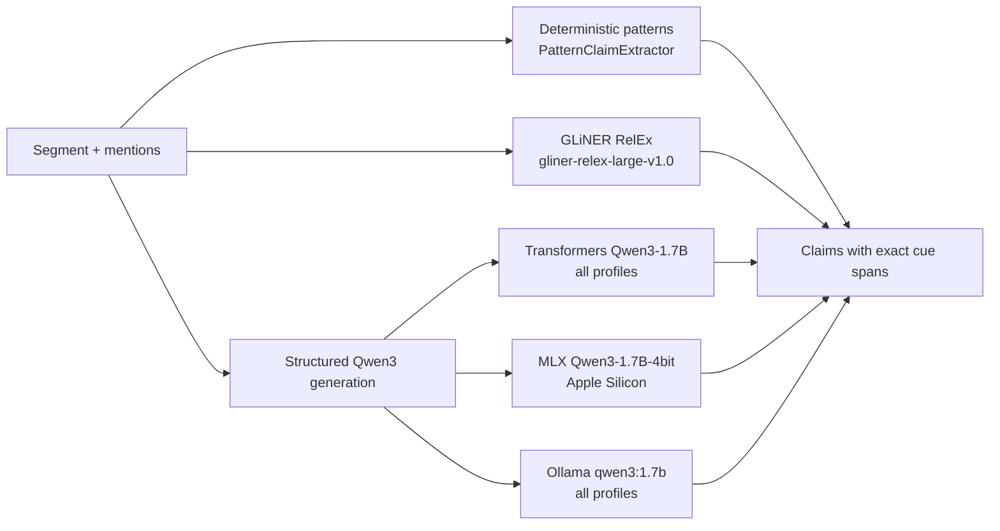
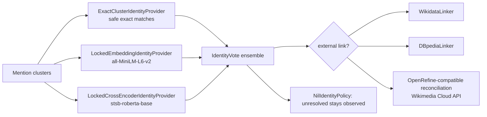
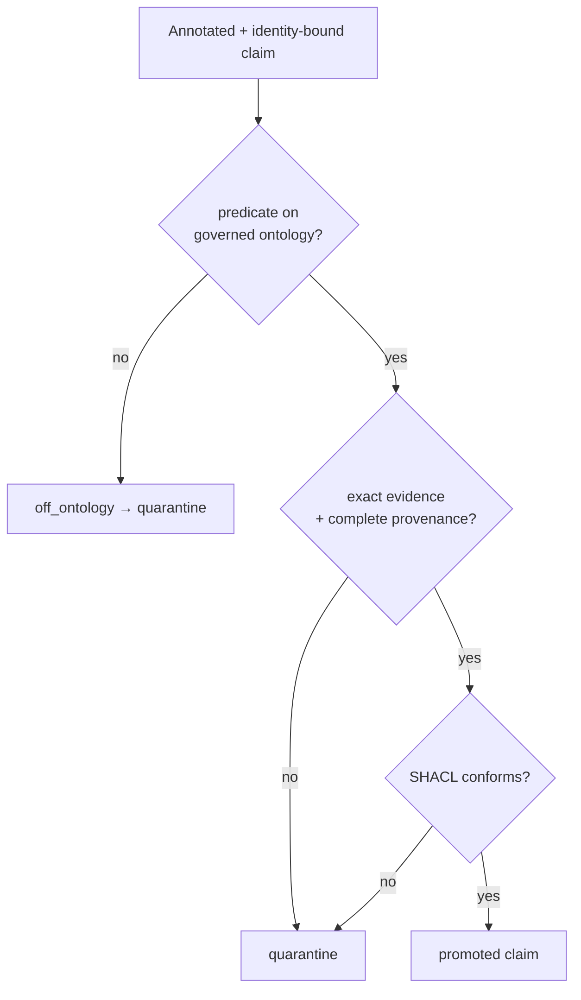

# Unstructured data → knowledge graph: techniques explained

This is the technical reference for **Pillar 2**: converting text (and HTML,
PDF, email, chat, scientific papers) into entities, claims, and events where
**every promoted fact quotes an exact source span and carries complete
provenance**.

The governing rule of this pillar: keep **four identity layers separate** and
never force an uncertain mention into an existing entity.

Contents:

1. [The evidence-first pipeline](#1-the-evidence-first-pipeline)
2. [The claim contract](#2-the-claim-contract-why-facts-are-reified)
3. [Stage-by-stage techniques](#3-stage-by-stage-techniques)
4. [The mention ensemble](#4-the-mention-ensemble-technique-detail)
5. [The claim / relation / event ensemble](#5-the-claim--relation--event-ensemble)
6. [Attribute extraction](#6-attribute-extraction-negation-modality-temporal-quantity-attribution)
7. [Identity resolution and linking](#7-identity-resolution-and-external-linking)
8. [Ontology alignment and the promotion gate](#8-ontology-alignment-and-the-shaclprovenance-promotion-gate)
9. [Runtime profiles: deterministic vs model-backed](#9-runtime-profiles-deterministic-vs-model-backed)
10. [Legacy / comparison extractors](#10-legacy--comparison-extractors)

---

## 1. The evidence-first pipeline

**File:** `application/unstructured_pipeline.py` · **Registry:** `evidence_first_unstructured_pipeline`, `mandatory_composed_unstructured_runtime`

`UnstructuredPipeline.run()` executes eleven ordered stages. Source observations
stay immutable; a claim is promoted only after its offsets, document version,
provider provenance, confidence, and ontology predicate all pass.

Each stage has a hard exit gate (detailed in
[knowledge_graph_modelling.md](knowledge_graph_modelling.md), Pillar 2). The
most important: **every segment must reproduce `document_text[start:end]`
exactly** (start inclusive, end exclusive), and **exact-evidence coverage and
provenance coverage must both be 1.0** in the release fixture.

---

## 2. The claim contract (why facts are reified)

**File:** `domain/claim.py`

A fact is not flattened into a bare `(subject, predicate, object)` edge
prematurely. It is an immutable, reified `Claim` that preserves the qualifiers a
plain edge would lose.

`has_complete_provenance()` is the promotion gate: a claim is promotable only
when its document digest matches, every evidence and semantic span is exact,
extractor/provider/model-revision/configuration/confidence all exist, confidence
meets policy, and the predicate is on the governed ontology. `TextSpan` uses
end-exclusive offsets aligned to the [W3C Web Annotation selector
model](https://www.w3.org/TR/selectors-states/); provenance follows
[PROV-O](https://www.w3.org/TR/prov-o/).

---

## 3. Stage-by-stage techniques

| Stage | Deterministic default | Model-backed (certified) | Technique |
| --- | --- | --- | --- |
| U0 doc version | `DocumentRef.from_source` | same | Content digest + version id; a changed doc = a new version |
| U1 segmentation | `RuleSegmenter` | same | Split into sentences/paragraphs retaining absolute offsets + quote/prefix/suffix |
| U2 mentions | `RuleMentionDetector` | `MandatoryMentionEnsemble` | Union of specialist recognizers with provider-agreement ratios |
| U3 coreference | `ConservativeCoreferenceResolver` | same/statistical | Safe exact clustering; ambiguous stays NIL |
| U4 claims | `PatternClaimExtractor` | `MandatoryClaimEnsemble` | Subject-predicate-object + event roles with exact cue spans |
| U4b attributes | `RuleAttributeExtractor` | same | Negation / modality / temporal / quantity / attribution cues |
| U5 identity | `KeepUnresolvedResolver` / `ExplicitNilObservedResolver` | `ProviderIdentityResolver` + `MandatoryCanonicalIdentityEnsemble` | Merge only safe cases; keep NIL otherwise |
| U5 ontology/SHACL | `GovernedClaimShaclGate` | same | Predicate must align to governed schema; RDF must conform |
| U6 materialization | builders | builders | Emit doc/mention/identity/claim/event as distinct resources |

---

## 4. The mention ensemble (technique detail)

**Files:** `infrastructure/extractors/model_backed/mentions.py`,
`infrastructure/extractors/{regex,gazetteer}.py`

Every applicable profile runs **all** of these providers; the union is kept with
provider-agreement ratios. A disagreement is information, not a reason to erase a
supported mention. Any mandatory provider failure fails the stage *after* the
others have been attempted.

| Provider | Model / basis | Why it is a *separate* mandatory provider |
| --- | --- | --- |
| `RuleMentionDetector` | regex + gazetteer | Exact structured entities (dates, emails, IDs, versions) |
| `GlinerMentionDetector` | `gliner-community/gliner_small-v2.5` | Open-label, parallel zero-shot NER ([NAACL 2024](https://aclanthology.org/2024.naacl-long.300/)) — not an LLM synonym |
| `TransformersMentionDetector` | `dslim/bert-base-NER` | Supervised token classification |
| `SpacyMentionDetector` | `spacy/en_core_web_sm` | Statistical NER, CPU-only |

**Exact-span evaluation is deliberately separate from label/name evaluation.**
Matching is on `(document version, start, end, type, occurrence)`, so a boundary
error cannot hide behind entity F1, and NIL behaviour is reported explicitly
(motivated by the [EMNLP 2023 in-depth entity-linking
evaluation](https://aclanthology.org/2023.emnlp-main.411/)).

---

## 5. The claim / relation / event ensemble

**Files:** `infrastructure/extractors/model_backed/{claims,relations}.py`

Three independent extraction paths run so the contract never depends on one model
family or one decoding path:

The structured response schema (`StructuredClaimResponse`) covers subject,
predicate, object, event roles, evidence, negation, modality, attribution, time,
quantity, and confidence. **Values and cues require exact spans.**
Relation/fact/intent claims require an object; events require typed roles.

| Path | Basis | Role |
| --- | --- | --- |
| `PatternClaimExtractor` | `_RELATION_PATTERNS` regex (affected, uses, depends_on, located_in, part_of, reports_to, contains…) | Deterministic, offline-testable floor |
| `GlinerRelExClaimExtractor` | `knowledgator/gliner-relex-large-v1.0` | Joint entity+relation extraction ([GLiNER-Relex](https://arxiv.org/abs/2605.10108)) |
| `TransformersQwenClaimExtractor` / `MlxQwenClaimExtractor` / `OllamaQwenClaimExtractor` | Qwen3-1.7B | Structured-schema LLM generation across three independent backends |

Held-out evaluation is document-level, not sentence-level, because relations
cross sentence boundaries ([DocRED](https://aclanthology.org/P19-1074/)).

> **License note:** the earlier REBEL relation extractor was removed from the
> product registry (its `cc-by-nc-sa` license is non-commercial). GLiNER RelEx
> (Apache-2.0) replaces it. The `TransformerRelationExtractor` class remains for
> research but is de-registered/de-certified.

---

## 6. Attribute extraction (negation, modality, temporal, quantity, attribution)

**File:** `application/unstructured_pipeline.py` (`RuleAttributeExtractor`)

Each claim is annotated with qualifier cues, each requiring an exact span:

| Attribute | Cue pattern (`re`) | Example → value |
| --- | --- | --- |
| negation | `no, not, never, without, failed to, didn't, n't` | "did not deploy" → `negated=true` |
| modality | possible: `may/might/could/possibly` · probable: `likely/probably` · hypothetical: `if/assuming/suppose` | "might affect" → `Modality.possible` |
| temporal | ISO dates, `in/during/before/after/since/until <period>`, `yesterday/today/tomorrow` | "since 2024" → temporal scope |
| quantity | `\d+ (%|kg|km|hours|days|items|units…)` | "40 hours" → quantity |
| attribution | `according to / reported by / stated by <Source>` | "according to Alice" → attribution |

These qualifiers are what make a **reified claim** more faithful than a bare
edge — "X did *not* cause Y, *reportedly*, in *2023*" survives intact.

---

## 7. Identity resolution and external linking

**Files:** `infrastructure/extractors/model_backed/identity.py`,
`infrastructure/resolution/`

The certified `MandatoryCanonicalIdentityEnsemble` votes across providers and
keeps NIL explicit rather than forcing a merge:

| Layer | Adapters | Technique |
| --- | --- | --- |
| deterministic | `ExactKeyEntityResolver`, `NormalizedStringResolver`, `AliasTableResolver` | Exact/normalized/alias key matching |
| fuzzy | `RapidFuzzResolver` | Edit-distance similarity |
| ML / embedding | `EmbeddingResolver`, `CrossEncoderResolver`, `Splink`, `Dedupe` | Vector similarity, probabilistic linkage, active learning |
| external | `WikidataLinker`, `DBpediaLinker`, `OpenRefineReconciler` | Link to a public KB via the [Reconciliation Service API](https://reconciliation-api.github.io/specs/latest/) |

**Ambiguous cases remain NIL/unresolved and can be quarantined — never forced to
the nearest name.** ER quality is measured with pairwise/cluster F1,
false-merge rate, false-split rate, NIL accuracy, and record-universe coverage
(see [evaluation_metrics.md](evaluation_metrics.md)).

---

## 8. Ontology alignment and the SHACL/provenance promotion gate

**Files:** `infrastructure/ontology/unstructured_governance.py`,
`infrastructure/ontology/ontology_alignment.py`, `infrastructure/ontology/shacl.py`

`GovernedClaimShaclGate` runs SHACL against the generated RDF. A claim with an
off-ontology predicate, an inexact span, missing provenance, or a SHACL
violation is quarantined, never silently written. The governed schema is
declared in a config like `configs/governed_unstructured_ontology.yaml`.

---

## 9. Runtime profiles: deterministic vs model-backed

`RuntimeProfile` selects which providers run:

| Profile | Providers | Use |
| --- | --- | --- |
| `DETERMINISTIC` (default) | Rule segmenter/mention/coref/claim/attribute + `KeepUnresolvedResolver` | Runs fully offline, no models — the testable contract floor |
| `MODEL_BACKED` (certified) | GLiNER, Transformers NER, spaCy, GLiNER RelEx, Qwen3 (Transformers + Ollama + MLX on Apple Silicon), embedding/cross-encoder identity, external linking | The release/hard-pass path |

Both profiles satisfy the *same* protocols (`Segmenter`, `MentionDetector`,
`CoreferenceResolver`, `ClaimExtractor`, `AttributeExtractor`,
`IdentityResolver`, `EntityLinkProvider`), so the deterministic path proves the
contract offline and the model-backed path fulfils it for real documents.

---

## 10. Legacy / comparison extractors

Kept in `research_registry()` for side-by-side comparison, not part of the
mandatory release surface:

| Technique | Basis | Status |
| --- | --- | --- |
| `openie_relation_extractor` | Open Information Extraction triples | implemented |
| `dependency_pattern_relation_extractor` | Dependency-parse patterns | implemented |
| `ollama_graph_extractor` | Single-shot LLM graph extraction | implemented (optional adapter) |
| `gliner_ollama_relation_typing_extractor` | GLiNER spans → Ollama relation typing | implemented (hybrid) |
| `transformer_relation_extractor` | Supervised transformer RE | adapter (de-certified) |
| `spacy_entity_ruler_extractor`, `coreference_adapter`, `pos_tagging_adapter` | spaCy components | stub/roadmap |

See runnable commands in the
[README run guide](../README.md#running-every-technique) and how to test each in
the [testing guide](testing_guide.md).
