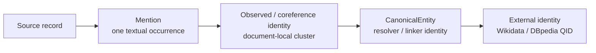
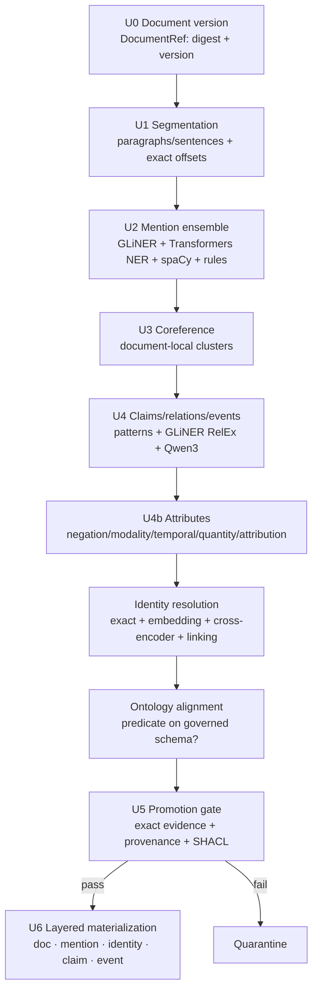
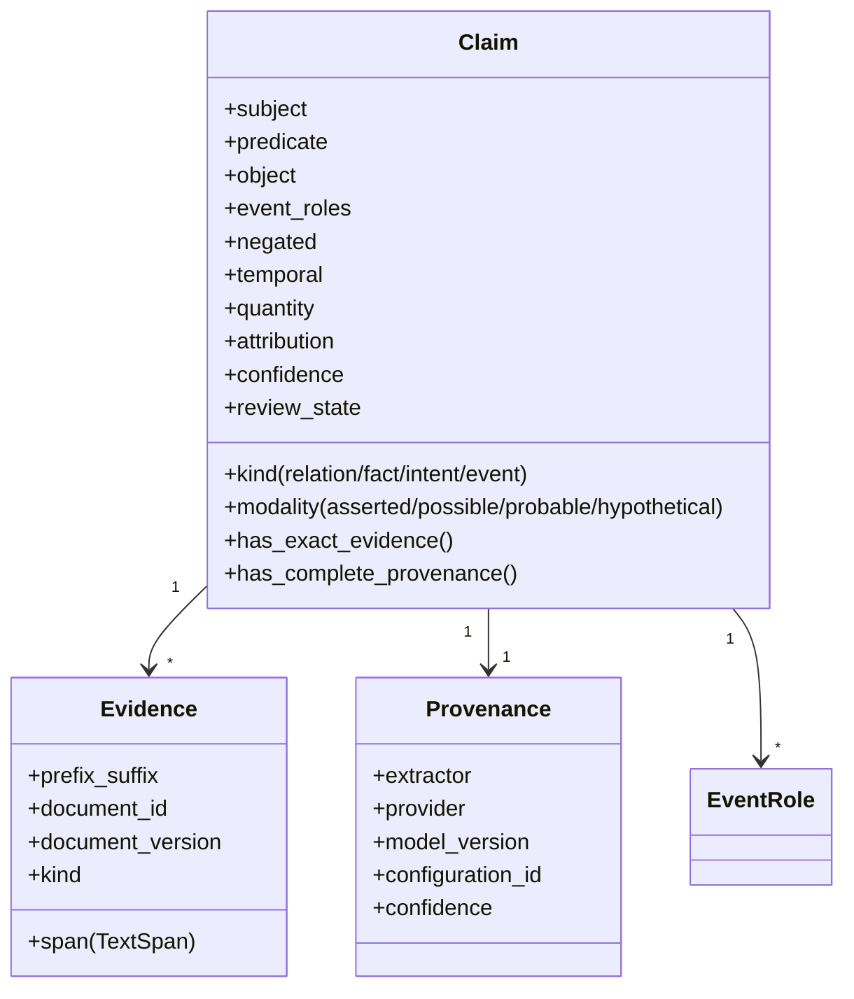
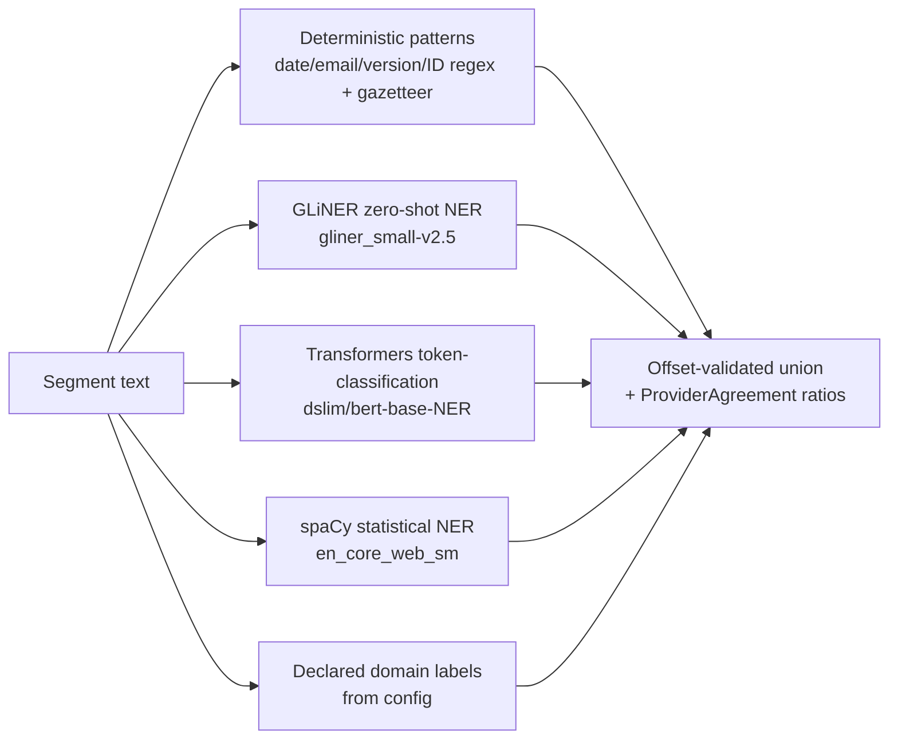
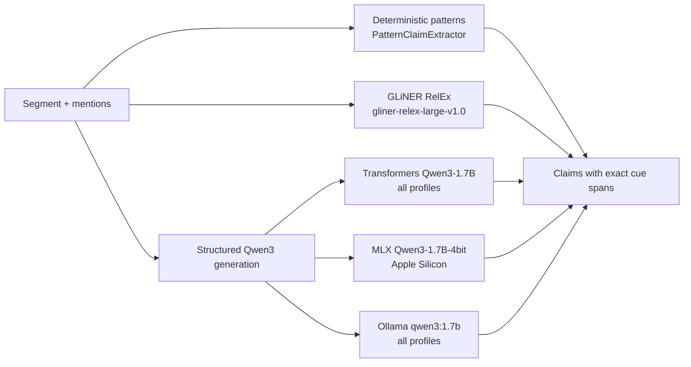
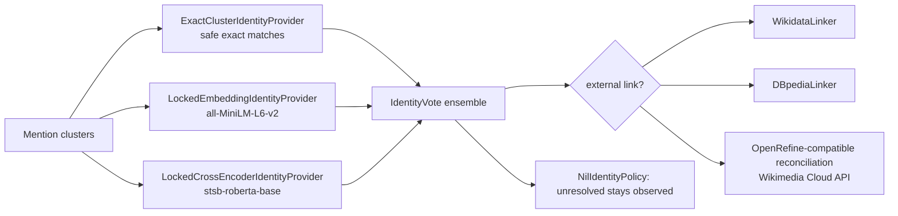
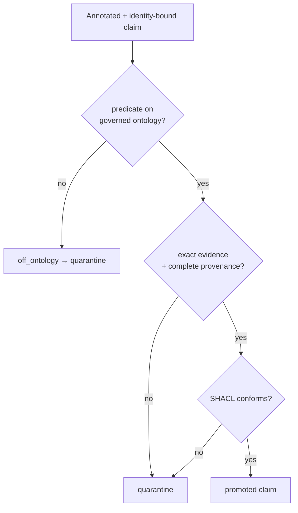

# Unstructured data → knowledge graph: techniques explained

[Documentation home](README.md) / Unstructured construction techniques

This guide explains **Pillar 2**: converting text, HTML, PDF, email, chat, and scientific papers into entities, evidence-grounded semantic assertions, and events. Read the [repository architecture](architecture.md) for package boundaries or the [formation contract](knowledge_graph_modelling.md#pillar-2-unstructured-data-to-knowledge-graph) for normative stage gates.

- **Every promoted fact quotes an exact source span.**
- **Every promoted fact carries complete provenance.**

The governing rules of this pillar are:

- **Keep four identity layers separate** (below).
- **Never force an uncertain mention** into an existing entity.

> **Draft versus certified execution:** `convert(data, "text")` returns a draft graph plus computed metrics for inspection. Publishability requires the locked provider bundle and zero-skip hard pass. GLiNER, Transformers, spaCy, GLiNER RelEx, Qwen3 backends, identity models, and graph services are platform-applicable mandatory certification components, never optional release enhancements.

Canonical product namespace: `kg_construction.unstructured`.

| Layer | Represents | Must not be confused with |
| --- | --- | --- |
| source/document version | one immutable input snapshot | a mutable file name or URL |
| mention | one exact textual occurrence | the real-world entity |
| observed identity | a document-local coreference cluster | a global canonical identity |
| canonical entity | a resolver-created identity | an external knowledge-base identifier |
| external identity | a governed public-KB link | a forced match for an ambiguous mention |

## Guide map

| Question | Start here |
| --- | --- |
| How does text move from source to graph? | [Evidence-first pipeline](#1-the-evidence-first-pipeline) |
| Why are facts represented as resources before edges? | [Semantic-assertion contract](#2-the-semantic-assertion-contract-why-facts-are-reified) |
| Which providers execute? | [Mention ensemble](#4-the-mention-ensemble-technique-detail) and [assertion ensemble](#5-the-claim--relation--event-ensemble) |
| How are uncertain identities handled? | [Identity resolution](#7-identity-resolution-and-external-linking) |
| What may enter the published graph? | [Promotion gate](#8-ontology-alignment-and-the-shaclprovenance-promotion-gate) |

Detailed contents:

1. [The evidence-first pipeline](#1-the-evidence-first-pipeline)
2. [The semantic-assertion contract](#2-the-semantic-assertion-contract-why-facts-are-reified)
3. [Stage-by-stage techniques](#3-stage-by-stage-techniques)
4. [The mention ensemble](#4-the-mention-ensemble-technique-detail)
5. [The claim / relation / event ensemble](#5-the-claim--relation--event-ensemble)
6. [Attribute extraction](#6-attribute-extraction-negation-modality-temporal-quantity-attribution)
7. [Identity resolution and linking](#7-identity-resolution-and-external-linking)
8. [Ontology alignment and the promotion gate](#8-ontology-alignment-and-the-shaclprovenance-promotion-gate)
9. [Draft and certified runtime boundaries](#9-draft-and-certified-runtime-boundaries)
10. [Mandatory and research extractors](#10-mandatory-and-research-extractors)

---

## 1. The evidence-first pipeline

**Public modules:** `kg_construction.unstructured.pipeline` and `kg_construction.unstructured.runtime` · **Registry:** `evidence_first_unstructured_pipeline`, `mandatory_composed_unstructured_runtime`

- **Eleven ordered stages** — `UnstructuredPipeline.run()` runs them in sequence.
- **Observations stay immutable** — nothing is rewritten in place.
- **Promotion is gated** — a claim promotes only after its offsets, document version, provider provenance, confidence, and ontology predicate all pass.

Each stage has a hard exit gate defined by the [unstructured formation contract](knowledge_graph_modelling.md#pillar-2-unstructured-data-to-knowledge-graph). The two that matter most:

- **Segments must reproduce the source exactly** — `document_text[start:end]` (start inclusive, end exclusive).
- **Coverage must be perfect** — exact-evidence and provenance coverage both `= 1.0` in the release fixture.

---

## 2. The semantic-assertion contract (why facts are reified)

**Public contract:** `kg_construction.unstructured.Claim` (implemented by the shared immutable domain contract)

- **Facts are not flattened prematurely** — no bare `(subject, predicate, object)` edge up front.
- **A `Claim` is an immutable, reified semantic assertion** — the implementation name does not represent a business domain; it preserves qualifiers a plain edge would lose.

`has_complete_provenance()` is the promotion gate. A claim is promotable **only when all** of the following hold:

- **document digest matches**;
- **every evidence and semantic span is exact**;
- **extractor / provider / model-revision / configuration / confidence all exist**;
- **confidence meets policy**; and
- **the predicate is on the governed ontology**.

Standards alignment:

- **Spans** — `TextSpan` uses end-exclusive offsets aligned to the [W3C Web Annotation selector model](https://www.w3.org/TR/selectors-states/).
- **Provenance** — follows [PROV-O](https://www.w3.org/TR/prov-o/).

---

## 3. Stage-by-stage techniques

| Stage | Draft contract implementation | Certified execution | Technique |
| --- | --- | --- | --- |
| U0 doc version | `DocumentRef.from_source` | same | Content digest + version id; a changed doc = a new version |
| U1 segmentation | `RuleSegmenter` | same | Split into sentences/paragraphs retaining absolute offsets + quote/prefix/suffix |
| U2 mentions | `RuleMentionDetector` | `MandatoryMentionEnsemble` | Union of specialist recognizers with provider-agreement ratios |
| U3 coreference | `ConservativeCoreferenceResolver` | same/statistical | Safe exact clustering; ambiguous stays NIL |
| U4 claims | `PatternClaimExtractor` | `MandatoryClaimEnsemble` | Subject-predicate-object + event roles with exact cue spans |
| U4b attributes | `RuleAttributeExtractor` | same | Negation / modality / temporal / quantity / attribution cues |
| U5 identity | `KeepUnresolvedResolver` / `ExplicitNilObservedResolver` | `ProviderIdentityResolver` + `MandatoryCanonicalIdentityEnsemble` | Merge only safe cases; keep NIL otherwise |
| U5 ontology/SHACL | `GovernedClaimShaclGate` | same | Predicate must align to governed schema; RDF must conform |
| U6 materialization | builders | builders | Emit doc/mention/identity/claim/event as distinct resources |

---

## 4. The mention ensemble (technique detail)

**Runtime implementations:** `kg_construction.infrastructure.extractors.model_backed.mentions`, `kg_construction.infrastructure.extractors.regex`, and `kg_construction.infrastructure.extractors.gazetteer`

- **All providers run** — every applicable profile runs each one; the union is kept with provider-agreement ratios.
- **Disagreement is information** — not a reason to erase a supported mention.
- **Failure is aggregated** — a mandatory provider failure fails the stage *after* the others have been attempted.

| Provider | Model / basis | Why it is a *separate* mandatory provider |
| --- | --- | --- |
| `RuleMentionDetector` | regex + gazetteer | Exact structured entities (dates, emails, IDs, versions) |
| `GlinerMentionDetector` | `gliner-community/gliner_small-v2.5` | Open-label, parallel zero-shot NER ([NAACL 2024](https://aclanthology.org/2024.naacl-long.300/)) — not an LLM synonym |
| `TransformersMentionDetector` | `dslim/bert-base-NER` | Supervised token classification |
| `SpacyMentionDetector` | `spacy/en_core_web_sm` | Statistical NER, CPU-only |

- **Exact-span evaluation is separate from label/name evaluation** — by design.
- **Matching key** — `(document version, start, end, type, occurrence)`, so a boundary error cannot hide behind entity F1.
- **NIL is reported explicitly** — motivated by the [EMNLP 2023 in-depth entity-linking evaluation](https://aclanthology.org/2023.emnlp-main.411/).

---

## 5. The claim / relation / event ensemble

**Runtime implementations:** `kg_construction.infrastructure.extractors.model_backed.claims` and `kg_construction.infrastructure.extractors.model_backed.relations`

Three independent extraction paths run so the contract never depends on one model family or one decoding path:

- **Rich response schema** — `StructuredClaimResponse` covers subject, predicate, object, event roles, evidence, negation, modality, attribution, time, quantity, and confidence.
- **Values and cues require exact spans.**
- **Narrow span repair remains evidence-bound** — an offset is realigned only when an exact source quote has one unambiguous occurrence. The field-shift repair accepts only an exact prompt segment with exact subject, predicate, object, and evidence anchors; absent or ambiguous quotes still fail closed.
- **Shape rules** — relation/fact/intent claims require an object; events require typed roles.

| Path | Basis | Role |
| --- | --- | --- |
| `PatternClaimExtractor` | `_RELATION_PATTERNS` regex (affected, uses, depends_on, located_in, part_of, reports_to, contains…) | Deterministic, offline-testable floor |
| `GlinerRelExClaimExtractor` | `knowledgator/gliner-relex-large-v1.0` | Joint entity+relation extraction ([GLiNER-Relex](https://arxiv.org/abs/2605.10108)) |
| `TransformersQwenClaimExtractor` / `MlxQwenClaimExtractor` / `OllamaQwenClaimExtractor` | Qwen3-1.7B | Structured-schema LLM generation across three independent backends |

- **Evaluation is document-level, not sentence-level** — relations cross sentence boundaries ([DocRED](https://aclanthology.org/P19-1074/)).

> **License note:** the earlier REBEL relation extractor was removed from the product registry (its `cc-by-nc-sa` license is non-commercial). GLiNER RelEx (Apache-2.0) replaces it. The `TransformerRelationExtractor` class remains for research but is de-registered/de-certified.

---

## 6. Attribute extraction (negation, modality, temporal, quantity, attribution)

**Public module:** `kg_construction.unstructured.pipeline` (`RuleAttributeExtractor`)

Each claim is annotated with qualifier cues, each requiring an exact span:

| Attribute | Cue pattern (`re`) | Example → value |
| --- | --- | --- |
| negation | `no, not, never, without, failed to, didn't, n't` | "did not deploy" → `negated=true` |
| modality | possible: `may/might/could/possibly` · probable: `likely/probably` · hypothetical: `if/assuming/suppose` | "might affect" → `Modality.possible` |
| temporal | ISO dates, `in/during/before/after/since/until <period>`, `yesterday/today/tomorrow` | "since 2024" → temporal scope |
| quantity | `\d+ (%|kg|km|hours|days|items|units…)` | "40 hours" → quantity |
| attribution | `according to / reported by / stated by <Source>` | "according to Alice" → attribution |

- **Why qualifiers matter** — they make a **reified claim** more faithful than a bare edge: "X did *not* cause Y, *reportedly*, in *2023*" survives intact.

---

## 7. Identity resolution and external linking

**Runtime implementations:** `kg_construction.infrastructure.extractors.model_backed.identity` and `kg_construction.infrastructure.resolution`

The certified `MandatoryCanonicalIdentityEnsemble` votes across providers and keeps NIL explicit rather than forcing a merge:

| Layer | Adapters | Technique |
| --- | --- | --- |
| deterministic | `ExactKeyEntityResolver`, `NormalizedStringResolver`, `AliasTableResolver` | Exact/normalized/alias key matching |
| fuzzy | `RapidFuzzResolver` | Edit-distance similarity |
| ML / embedding | `EmbeddingResolver`, `CrossEncoderResolver`, `Splink`, `Dedupe` | Vector similarity, probabilistic linkage, active learning |
| external | `WikidataLinker`, `DBpediaLinker`, `OpenRefineReconciler` | Link to a public KB via the [Reconciliation Service API](https://reconciliation-api.github.io/specs/latest/) |

- **Ambiguity stays NIL** — unresolved cases can be quarantined, never forced to the nearest name.
- **ER quality is measured** — pairwise/cluster F1, false-merge rate, false-split rate, NIL accuracy, and record-universe coverage (see [evaluation_metrics.md](evaluation_metrics.md)).

---

## 8. Ontology alignment and the SHACL/provenance promotion gate

**Runtime implementations:** `kg_construction.infrastructure.ontology.unstructured_governance`, `kg_construction.infrastructure.ontology.ontology_alignment`, and `kg_construction.infrastructure.ontology.shacl`

- **SHACL runs on the generated RDF** — via `GovernedClaimShaclGate`.
- **Four ways to be quarantined** — off-ontology predicate, inexact span, missing provenance, or a SHACL violation; none are silently written.
- **Audit and publication batches are distinct** — draft extraction retains quarantined resources and diagnostics for review. The mandatory publication boundary removes those resources and every incident relation/fact before external identity resolution, final resource SHACL, and graph projection; exclusion counts and IDs remain in audit metadata.
- **The release schema is package-owned** — `src/kg_construction/resources/governed_unstructured_ontology.yaml` is bound by the publication contract. The copy under `configs/` is a readable example, not an independent release authority.

---

## 9. Draft and certified runtime boundaries

Draft conversion and certification have different evidence claims:

| Boundary | Execution | What the result proves |
| --- | --- | --- |
| Draft `convert` | Contract-level extraction selected for inspection | A graph and observations were produced; failures can be inspected |
| Certified platform profile | Every platform-applicable rule/model/identity provider and store | The complete locked runtime executed with zero skips/fallbacks |

Both boundaries use the same protocols (`Segmenter`, `MentionDetector`, `CoreferenceResolver`, `ClaimExtractor`, `AttributeExtractor`, `IdentityResolver`, and `EntityLinkProvider`), but protocol compatibility is not provider-execution evidence.

The certified provider set cannot be reduced through runtime configuration. Apple Silicon adds mandatory MLX execution; Linux declares MLX inapplicable.

---

## 10. Mandatory and research extractors

Implemented product extractors in the release manifest execute in the zero-skip hard pass. Research and roadmap implementations remain separate and are never substituted for a mandatory provider:

| Technique | Basis | Status |
| --- | --- | --- |
| `openie_relation_extractor` | Open Information Extraction triples | implemented; mandatory hard-pass execution |
| `dependency_pattern_relation_extractor` | Dependency-parse patterns | implemented; mandatory hard-pass execution |
| `ollama_graph_extractor` | Single-shot LLM graph extraction | implemented; mandatory hard-pass execution |
| `gliner_ollama_relation_typing_extractor` | GLiNER spans → Ollama relation typing | implemented; mandatory hard-pass execution |
| `transformer_relation_extractor` | Supervised transformer RE | research adapter; never a release fallback |
| `spacy_entity_ruler_extractor`, `coreference_adapter`, `pos_tagging_adapter` | spaCy components | stub/roadmap |

## Next steps

| Goal | Continue with |
| --- | --- |
| Run a first text conversion | [Getting started](getting_started.md) |
| Configure models, identity providers, ontology, and promotion thresholds | [Configuration](configuration.md) |
| Understand extraction, identity, evidence, and intended-use metrics | [Evaluation metrics](evaluation_metrics.md) |
| Trace the implementation stage by stage | [Stage-by-stage implementation](stage_by_stage_implementation.md) |
| Verify providers and publication gates | [Testing guide](testing_guide.md) |

Research adapters can be explored through `kg_construction.research` and `make research-smoke`. They do not establish provider participation or publishability. The runnable product commands are also summarized in the [project README](../README.md).
