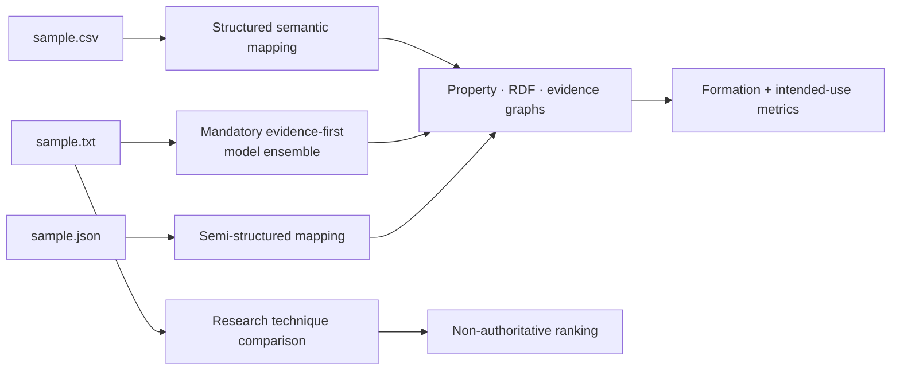

# Examples

These examples provide small, inspectable entry points for the repository’s structured construction, unstructured construction, evaluation, and research APIs.

[Project overview](../README.md) · [Getting started](../docs/getting_started.md) · [Configuration](../docs/configuration.md) · [Testing guide](../docs/testing_guide.md) · [Generated-output policy](../data/processed/README.md)

## Example map



| Example | Purpose | Execution class |
| --- | --- | --- |
| [`quickstart.py`](quickstart.py) | Construct and evaluate the CSV and text samples, then preview RDF, Neo4j, and NetworkX exports | Product draft using the complete applicable provider profile |
| [`research_technique_comparison.py`](research_technique_comparison.py) | Compare two text-construction techniques through `kg_construction.research` | Non-authoritative research |
| [`data_to_kg/sample.csv`](data_to_kg/sample.csv) | People, manager foreign keys, and shared team categories | Structured sample |
| [`data_to_kg/sample.json`](data_to_kg/sample.json) | Nested service and owner records | Semi-structured sample |
| [`data_to_kg/sample.txt`](data_to_kg/sample.txt) | Incident, team, date, service, contact, URL, and version mentions | Unstructured sample |

## Run the product examples

Provision every dependency, model, and service applicable to the selected platform:

```bash
make setup
uv run kg-construction doctor --strict
```

Run the Python quickstart:

```bash
make quickstart
```

`quickstart.py` prints a JSON summary with source profiling, graph counts, executed and missing metric families, intended-use status, publication-gate status, and export previews. It does not turn a draft into a certificate.

Run the CLI product smoke flows and write all graph and evaluation projections under `data/processed/`:

```bash
make product-smoke
```

| Product-smoke input | Construction configuration | Graph-bound evaluation suite |
| --- | --- | --- |
| [`sample.csv`](data_to_kg/sample.csv) | [`data_to_kg_complete.example.yaml`](../configs/data_to_kg_complete.example.yaml) | [`graph_evaluation_suite.sample_csv.yaml`](../configs/graph_evaluation_suite.sample_csv.yaml) |
| [`sample.txt`](data_to_kg/sample.txt) | [`data_to_kg_complete.example.yaml`](../configs/data_to_kg_complete.example.yaml) | [`graph_evaluation_suite.sample_text.yaml`](../configs/graph_evaluation_suite.sample_text.yaml) |

The text path executes the locked, platform-applicable GLiNER, Transformers, spaCy, Ollama, identity-resolution, and external-reconciliation providers, plus MLX on Apple Silicon. A provider failure fails the run; the example does not silently switch to a smaller profile.

## Run the research example

Install the repository’s mandatory dependency set, then run:

```bash
uv run python examples/research_technique_comparison.py
```

The result is explicitly labelled `research_only`. Its weighted best technique is a fixture-scoped comparison and cannot replace graph formation, task-correctness, intended-use, or certification gates.

The full research smoke flow uses [`evaluation.example.yaml`](../configs/evaluation.example.yaml):

```bash
make research-smoke
```

## Configuration pointers

| Need | Configuration |
| --- | --- |
| Complete structured and model-backed construction | [`data_to_kg_complete.example.yaml`](../configs/data_to_kg_complete.example.yaml) |
| General configurable conversion | [`convert_configurable.example.yaml`](../configs/convert_configurable.example.yaml) |
| Governed unstructured ontology | [`governed_unstructured_ontology.yaml`](../configs/governed_unstructured_ontology.yaml) |
| Production graph-store ingestion | [`production_ingestion.example.yaml`](../configs/production_ingestion.example.yaml) |
| Integration profiles | [`integration_profiles.example.yaml`](../configs/integration_profiles.example.yaml) |
| Graph ML research | [`graph_ml.example.yaml`](../configs/graph_ml.example.yaml) |

Read the [configuration reference](../docs/configuration.md) before adapting a sample. Example graphs and reports are drafts unless the separate [mandatory certification contract](../certification/README.md) passes with fresh, zero-skip evidence.

Keep downloaded experiment datasets in the ignored [external-data workspace](../data/external/README.md), and write generated graphs and evaluations to the ignored [processed-data workspace](../data/processed/README.md).
