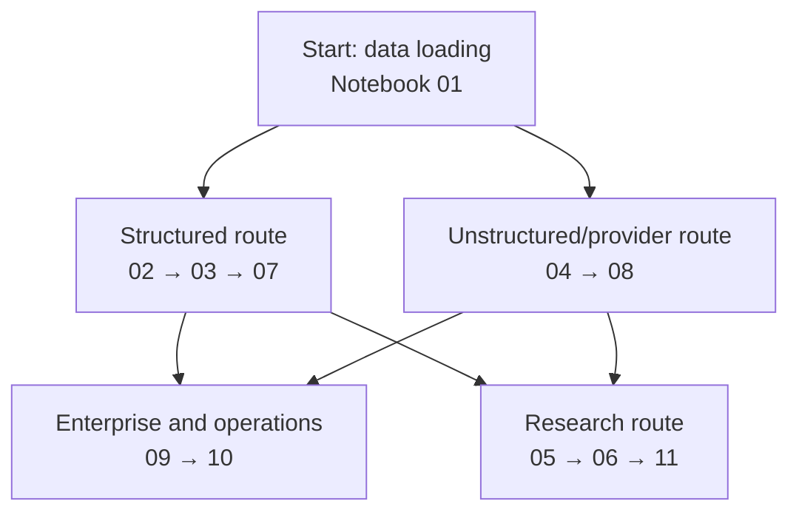

# Notebooks

The notebooks are output-free learning artifacts. They explain APIs and modelling decisions, but they are not mandatory-provider execution evidence and never establish publishability.

[Project overview](../README.md) · [Documentation map](../docs/README.md) · [Getting started](../docs/getting_started.md) · [Testing guide](../docs/testing_guide.md) · [Research boundary](../research/README.md)

## Setup

Install the repository’s mandatory dependency set and start Jupyter:

```bash
uv sync --frozen --all-groups
uv run jupyter lab
```

For live models and stores, provision and validate the selected platform profile first:

```bash
make setup
uv run kg-construction doctor --strict
```

Certification—not a notebook—proves that every platform-applicable provider and store executed.

## Choose a learning route



| Goal | Suggested route |
| --- | --- |
| Learn structured modelling and standards | 01 → 02 → 03 → 07 |
| Learn unstructured extraction and identity interfaces | 01 → 04 → 08 |
| Learn enterprise ingestion and graph-store export | 01 → 09 → 10 |
| Explore evaluation, Graph ML, and retrieval research | 05 → 06 → 11 |

## Product learning path

| Notebook | Pillar | What it demonstrates |
| --- | --- | --- |
| [01 · Data loading and profiling](01_data_loading_and_profiling.ipynb) | Shared ingestion | Source records and profiling across supported formats |
| [02 · Structured schema mapping and RDF](02_structured_schema_mapping_rdf.ipynb) | Structured | Semantic rows, schema proposal, validation, and graph projections |
| [03 · JSONPath, XML, and semi-structured mapping](03_jsonpath_xml_semistructured_mapping.ipynb) | Structured | JSONPath, dotted path, XML, and exact source-path evidence |
| [07 · Standards mapping and virtual KG](07_standards_mapping_and_virtual_kg.ipynb) | Structured | R2RML, RML, CSVW, JSON-LD, and OBDA |
| [09 · Enterprise events and observability](09_enterprise_events_and_observability.ipynb) | Structured and unstructured ingestion | Enterprise documents, events, logs, and metadata mapping |

Canonical product imports use `kg_construction.structured`, `kg_construction.unstructured`, and `kg_construction.evaluation`.

## Provider and store illustrations

These notebooks use controlled or fake transports to teach an interface without requiring a long live execution. That is unit-style illustration, not proof of provider availability:

| Notebook | Illustration | Evidence level |
| --- | --- | --- |
| [04 · Text extraction, GLiNER, Ollama, and labels](04_text_extraction_gliner_ollama_labels.ipynb) | Regex and gazetteer extraction plus GLiNER and Ollama interface wiring | Interface demonstration |
| [08 · Relation extraction and entity linking](08_relation_extraction_and_entity_linking.ipynb) | Relation extraction, resolution, and external-linking interfaces | Interface demonstration |
| [10 · Graph-store ingestion and exports](10_graph_store_ingestion_and_exports.ipynb) | Transactional graph-store calls, export, retry, and dead-letter behavior | Interface demonstration |

The real GLiNER, Transformers, spaCy, MLX, Ollama, embedding, cross-encoder, Neo4j, Memgraph, and Ladybug executions are mandatory in the applicable certification profile and are exercised by:

```bash
bash run_all_approaches.sh
```

## Research notebooks

These notebooks belong conceptually to `kg_construction.research`:

| Notebook | Research purpose | Interpretation |
| --- | --- | --- |
| [05 · Evaluation, resolution, and production hardening](05_evaluation_resolution_production_hardening.ipynb) | Technique ranking examples alongside operational utilities | Non-authoritative comparison |
| [06 · Graph ML capabilities](06_graph_ml_capabilities.ipynb) | Graph analytics, embeddings, and link prediction | Research experiment |
| [11 · Gold benchmarks and retrieval](11_gold_benchmarks_and_retrieval.ipynb) | Comparison fixtures, Graph ML preparation, retrieval comparisons, and store sizing | Fixture-scoped research |

Their scores and mocked runs are non-authoritative. Core formation, task, and intended-use evaluation remains under `kg_construction.evaluation`.

## Capability catalogue

[`capability_coverage.yaml`](capability_coverage.yaml) maps techniques to learning locations. “Covered” means documented or illustrated; it does not mean a live provider executed. The certification manifest and nonce-bound evidence report are the only sources for mandatory execution claims.

Run the catalogue and notebook hygiene checks:

```bash
make notebook-check
```

The check verifies:

- Every referenced notebook exists.
- Every registered capability has a documented learning location.
- Research and roadmap extension points remain visible.
- Notebooks stay output-free and path-portable.

## Evidence labels

| Label | What it proves |
| --- | --- |
| Notebook illustration | A reader can follow an API or modelling pattern |
| Controlled or fake transport | Interface behavior under a deterministic test double |
| Product smoke | Representative end-to-end construction and graph-bound evaluation |
| Certification | Every applicable mandatory capability executed and passed with fresh evidence |

## Hygiene policy

- Do not commit notebook outputs or execution counts.
- Do not commit absolute local paths, credentials, source-derived private data, or downloaded model artifacts.
- Do not describe fake transports as live provider execution.
- Do not put research rankings in the product publication path.
- Write generated graphs and reports to `data/processed/` or the designated research workspace.
- Run `make notebook-check` before committing notebook changes.
