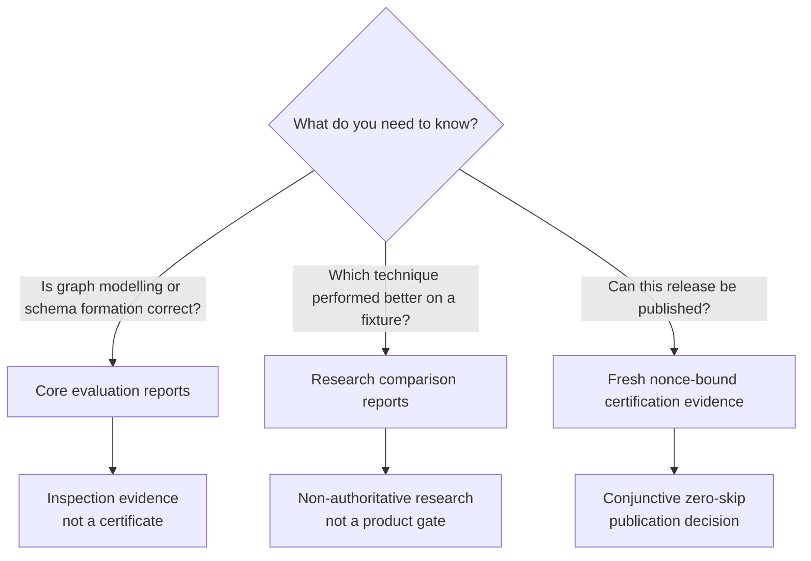
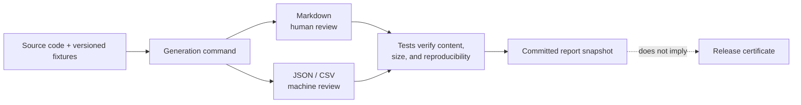

# Reports

This directory contains generated product-evaluation summaries and separately labelled research comparisons. They are useful for inspection and reproducibility, but neither class is automatically a release certificate.

[Project overview](../README.md) · [Evaluation metrics](../docs/evaluation_metrics.md) · [Testing guide](../docs/testing_guide.md) · [Certification contract](../certification/README.md) · [Research boundary](../research/README.md)

## Read the right artifact



| Artifact class | Answers | Does not answer |
| --- | --- | --- |
| Core construction and evaluation | Whether generated examples satisfy modelling, schema, registry, and evaluation checks | Whether every mandatory runtime capability executed for this release |
| Research comparison | How techniques compare on small, declared fixtures | Whether a graph is publishable or production-scale accuracy is proven |
| Certification evidence in runtime `results/` | Whether the locked profile passed every mandatory capability with fresh evidence | General technique ranking |

## Core construction and evaluation reports

These reports describe the three product pillars:

| Report | Formats | Purpose |
| --- | --- | --- |
| Modelling correctness | [Markdown](modelling_correctness.md) · [JSON](modelling_correctness.json) | Identity, categorical reuse, relationships, assertions, and formation invariants |
| Schema quality | [Markdown](schema_quality.md) · [JSON](schema_quality.json) | Schema projection and conformance checks |
| Capability summary | [Markdown](current_repo_capability_summary.md) | Human-readable product, research, and roadmap inventory |
| Registry summary | [JSON](current_registry_summary.json) | Machine-readable aggregate registry counts |
| Registry matrix | [CSV](current_registry_matrix.csv) | Row-level capability inventory |

Formation reports cover identity, categorical conciseness, relationship integrity, semantic-assertion evidence and provenance, schema conformance, and intended-use execution. A generated report is still not a release certificate; publishability requires the nonce-bound zero-skip hard pass whose execution evidence is written under the ignored runtime `results/` workspace.

Evaluator implementations are owned by `kg_construction.evaluation`. Legacy `kg_construction.infrastructure.evaluation.*` imports are compatibility shims only and do not define a second or wildcard evaluation façade.

Refresh the core reports:

```bash
make modelling-correctness
make schema-quality
make registry-reports
```

## Research comparison reports

These are non-authoritative `kg_construction.research` artifacts:

| Report | Formats | Scope |
| --- | --- | --- |
| Technique leaderboard | [Markdown](benchmark_leaderboard.md) · [CSV](benchmark_leaderboard.csv) | Small deterministic technique comparison |
| Gold-standard benchmark story | [Markdown](gold_standard_benchmark_story.md) · [CSV](gold_standard_benchmark_story.csv) · [JSON](gold_standard_benchmark_story.json) | Worked benchmark and retrieval-evaluation narrative |
| Cross-source identity benchmark | [Markdown](cross_source_identity_benchmark.md) · [CSV](cross_source_identity_benchmark.csv) · [JSON](cross_source_identity_benchmark.json) | Targeted false-merge and false-split comparison |

Simple or weighted benchmark runners compare techniques and demonstrate evaluation wiring on declared fixtures. They do not prove production-scale accuracy, mandatory provider participation, or publishability.

Keep the interpretation precise:

- The cross-source fixture is a targeted false-merge and false-split comparison, not a construction schema.
- Retrieval `relevance` and `context_relevance` values are intended-use judgments, not graph facts.
- A weighted leaderboard score never overrides a formation, extraction, SHACL, runtime, or intended-use gate.

Generate research outputs separately:

```bash
make research-smoke
make cross-source-identity-benchmark
make gold-benchmark-story
```

High-volume experiment output belongs in the designated research workspace and should not be committed as authoritative documentation.

## Artifact lifecycle



Generated files should be reproducible from the checked-in scripts and fixtures. When changing an evaluator, registry descriptor, fixture, or report generator, regenerate the affected artifacts and include them in the same pull request.

## Terminology

| Term | Meaning |
| --- | --- |
| Registry `status` | Implementation state of a capability |
| Product, research, roadmap disposition | Whether a capability is mandatory, comparative, or planned |
| `Claim` | An evidence-grounded semantic assertion in unstructured reports, not a business domain |
| Report | Reproducible inspection artifact |
| Certificate | Fresh release-authorizing evidence produced only by the mandatory certification path |
