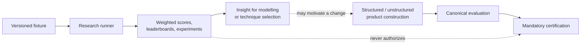

# Comparative research

This directory is the navigation boundary for non-authoritative experiments. Research compares techniques and explores extensions; it never decides whether a constructed graph or software release is publishable.

[Project overview](../README.md) · [Research Python API](../src/kg_construction/research/README.md) · [Reports guide](../reports/README.md) · [Evaluation metrics](../docs/evaluation_metrics.md) · [Certification contract](../certification/README.md)

## Product and research are separate



| Boundary | Owns | Decision |
| --- | --- | --- |
| `kg_construction.research` | Technique comparison, weighted ranking, deterministic leaderboards, Graph ML experiments, and synthetic fixtures | “Which experiment performed better under this declared setup?” |
| `kg_construction.evaluation` | Formation, task correctness, schema, identity, and intended-use metrics | “Is this graph correct and fit for its declared use?” |
| `kg_construction.certification` | Locked profiles and fresh semantic capability evidence | “May this release be published?” |

## Run research comparisons

Provision the mandatory repository dependencies first, then run the research smoke flow:

```bash
uv sync --frozen --all-groups
make research-smoke
```

The dedicated command is also available:

```bash
uv run kg-construction-research --help
```

Research can compare mapping, extraction, entity-resolution, graph-store, or Graph ML techniques. Weighted scores and leaderboards answer a fixture-scoped comparison question; they do not establish graph correctness, mandatory-provider participation, or release eligibility.

## Research asset map

| Asset | Purpose |
| --- | --- |
| [`src/kg_construction/research/`](../src/kg_construction/research/) | Executable comparison, benchmark, and experiment APIs |
| [`benchmarks/`](../benchmarks/) | Versioned research fixtures |
| [`scripts/generate_benchmark_leaderboard.py`](../scripts/generate_benchmark_leaderboard.py) | Deterministic technique leaderboard generation |
| [`scripts/generate_cross_source_identity_benchmark.py`](../scripts/generate_cross_source_identity_benchmark.py) | False-merge and false-split comparison generation |
| [`reports/benchmark_leaderboard.md`](../reports/benchmark_leaderboard.md) | Generated technique comparison |
| [`reports/cross_source_identity_benchmark.md`](../reports/cross_source_identity_benchmark.md) | Generated cross-source identity comparison |
| [`reports/gold_standard_benchmark_story.md`](../reports/gold_standard_benchmark_story.md) | Worked benchmark and retrieval story |
| [`notebooks/README.md`](../notebooks/README.md) | Research notebook catalogue and hygiene rules |
| [`configs/evaluation.example.yaml`](../configs/evaluation.example.yaml) | Example research evaluation configuration |

## Interpretation rules

- State the fixture, configuration, techniques, weights, thresholds, and runtime behind every comparison.
- Label mocked providers, synthetic data, and deterministic demonstrations explicitly.
- Treat cross-source identity fixtures as false-merge and false-split judgments, not construction schema.
- Treat retrieval `relevance` and `context_relevance` as intended-use judgments, not graph facts.
- Do not use weighted ranking to bypass any mandatory formation, extraction, schema, runtime, or intended-use gate.
- Keep high-volume experiment output in the designated research workspace rather than authoritative reports.

Construction correctness belongs to the structured, unstructured, and evaluation pillars. Release authorization belongs only to [`certification/`](../certification/).
