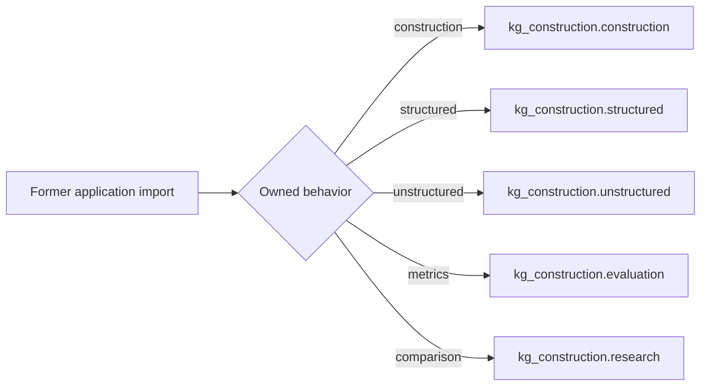

# Application compatibility layer

[Architecture](../../../docs/architecture.md) · [Documentation map](../../../docs/README.md) · [Migration guidance](../../../CHANGELOG.md)

`kg_construction.application` is an internal orchestration and compatibility layer. It is not a fourth product pillar.

Canonical feature ownership is:

| Responsibility | Canonical package |
| --- | --- |
| Structured modelling and construction | [`kg_construction.structured`](../structured/) |
| Evidence-grounded text construction | [`kg_construction.unstructured`](../unstructured/) |
| Formation, task, schema, identity, and intended-use metrics | [`kg_construction.evaluation`](../evaluation/) |
| End-to-end public construction API | [`kg_construction.construction`](../construction/) |
| Release registry and zero-skip hard pass | [`kg_construction.certification`](../certification/) |
| Non-authoritative comparisons and experiments | [`kg_construction.research`](../research/) |



Files whose module docstring starts with “Compatibility imports” preserve older import paths for one migration cycle. New source code and documentation must not add dependencies on those paths.

In particular, product evaluator implementations live in `kg_construction.evaluation`, not in `application` or `infrastructure.evaluation`. The former infrastructure evaluator modules use explicit named re-exports and preserve object identity; there is no wildcard evaluation façade.

Simple benchmarking, weighted technique evaluation, scoring, recommendation, and Graph ML belong to `kg_construction.research`. Same-named modules that remain under `application` are compatibility shims only.

For the public construction surface, import from the root package:

```python
from kg_construction import convert
```

Compatibility modules preserve imports; they do not create a second implementation or ownership boundary.
